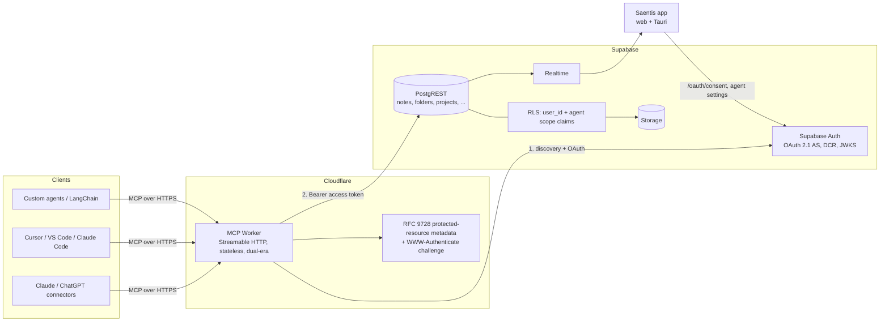

# AI agent / MCP integration — exploration

> **Status: exploration only.** No implementation has been done and no application
> code was modified. This document evaluates how Saentis Notes (this repo) can
> let AI agents read and write a user's notes after authenticating, with
> **MCP (Model Context Protocol)** as the primary integration surface.
>
> Deep-dive companions: [data-layer audit](./research/agent-integration-data-layer.md) ·
> [MCP ecosystem research](./research/mcp-ecosystem.md) ·
> [agent auth & security model](./research/agent-auth-model.md).
>
> Line references reflect the working tree at the time of writing. The tree has
> an in-progress offline-layer refactor (`lib/notes.ts`, `lib/folders.ts`,
> `lib/offline/*`), so line numbers may drift by a few lines.

Date: 2026-11-05 · Prepared as a decision document for the product owner.

---

## 1. Executive summary

**Goal.** A user can connect Claude, ChatGPT, Cursor, VS Code Copilot or a custom
agent to Saentis Notes. The agent authenticates as that user, sees only that
user's data, and can search, read and (when enabled) write notes.

**The app is well positioned.** Data ownership is already enforced by Supabase
RLS, every row carries `user_id`, and Supabase Auth now ships an OAuth 2.1
server designed for MCP clients. An MCP server can therefore be a *thin,
stateless projection over the existing tables* — no new data model, no second
source of truth, and the same RLS policies that protect the app protect the
agent.

**Recommended shape (v1).**

> A **remote MCP server** — Streamable HTTP, stateless, dual-era — deployed as a
> **new Cloudflare Worker**. Authentication is delegated to **Supabase Auth's
> OAuth 2.1 server** (beta), with a `/oauth/consent` page served by the web app.
> The Worker validates the Supabase access token and calls PostgREST **with that
> token**, so RLS scopes every read and write. Ship **read-only tools first**;
> add **guarded writes** behind an explicit "agents may write" toggle, an audit
> log, optimistic-concurrency preconditions and **no delete/publish tools**.
>
> If the Supabase-as-authorization-server spike fails against real clients, fall
> back to **scoped personal access tokens** for local clients (Claude Code,
> Cursor, VS Code) before building a custom authorization server. Do not ship a
> service-role proxy or accept the user's raw Supabase JWT at the MCP endpoint.

**Why not a local server first.** Every mainstream MCP client now supports
remote HTTP servers with OAuth, and a remote server needs zero Tauri packaging,
signing or notarisation. A stdio bridge only matters for legacy/local-only
clients; a true offline sidecar is a much larger project (see §3 Option B).

**Effort (one experienced full-stack dev, rough):**

| Phase | Scope | Estimate |
|---|---|---|
| 0 | Interop spike + foundation: Supabase signing keys, OAuth 2.1, consent page, Worker skeleton, token verification | ~1–2 weeks |
| 1 | Read-only MCP tools/resources, caps, audit, client smoke tests, Agents settings page | ~1.5–2.5 weeks |
| 2 | Guarded writes (create/append/update/move) + RLS scope claims + attribution + kill switch + open-editor conflict handling | ~2–3 weeks |
| 3 | Hardening: per-client scopes/bindings, revocation, quotas, activity UI, docs + directory submission | ~2–4 weeks |
| 4 | Optional: PATs for CLI/scripts, local stdio sidecar, tasks/calendar tools, mindmap generation, semantic search, MCP Apps | TBD |

**Top risks / must-decide items**

1. **The open editor silently loses agent edits.** Agent writes reach Supabase,
   but the currently open editor never reloads (`selectedNote` is only set on
   navigation), and because realtime refreshes the cache's `updated_at`, the
   editor's next 2 s autosave **passes the CAS check and overwrites the agent's
   change without a conflict**. Must be fixed before writes ship (§7.2).
2. **Hard deletes and no trash.** `deleteNote` is a hard delete; there is no
   recovery path except an in-memory toast that recreates rows with new UUIDs.
   Agents cannot be given delete until soft delete + Trash exist (§9).
3. **Content is HTML/JSON blobs, not Markdown.** Six note formats share one
   `text` column; there is no schema/version, no server validation, and a
   corrupt JSON body silently opens as an empty note. Agents must write through
   a narrow, sanitised Markdown→HTML path; five formats stay read-only.
4. **Supabase OAuth 2.1 is beta and does not fully match MCP `2026-07-28`.**
   Supabase documents MCP auth, but with **DCR** (deprecated by MCP in favour of
   CIMD) and tokens whose `aud` is `"authenticated"`, not the MCP resource. The
   spike (§10 Phase 0) must verify real-client interop before we commit.
5. **Protocol churn.** MCP `2026-07-28` is stateless (no `initialize`), and most
   installed clients still speak `2025-11-25`. Serve both eras through the SDK;
   do not hand-roll the wire protocol.
6. **Security is model-behaviour shaped, not transport shaped.** Note text is an
   injection channel; a read-scoped agent must not be able to call write tools,
   and write tools must not be able to exfiltrate or publish.

---

## 2. What the app is today (constraints that shape the design)

| Concern | Reality in this repo | Implication for agents |
|---|---|---|
| Runtime | Next.js 16 **static export** (`out/`) inside a **Tauri 2** shell, also on Cloudflare Pages ([`next.config.js`](../next.config.js), [README](../README.md)) | No Next server at runtime for the data path |
| Data path | Browser-side `supabase-js` only ([`lib/supabase.ts`](../lib/supabase.ts)); servers exist only for the AI proxy and account deletion ([`app/api/ai/chat/route.ts`](../app/api/ai/chat/route.ts), [`app/api/account/delete/route.ts`](../app/api/account/delete/route.ts)) | Agents need a new gateway that reuses the user's Supabase identity |
| Identity | Supabase email/password; session in `localStorage`; server routes verify `Authorization: Bearer <supabase access token>` via `auth.getUser(token)` | The Bearer pattern is the seed for MCP auth |
| Authorisation | RLS owner-only `auth.uid() = user_id` on all user tables (notes, folders, projects, tasks, calendar, journal, attachments, chats); public read for published shares only | RLS is the enforcement point; never bypass with the service role |
| Notes model | `notes(id, user_id, title, content text, folder_id, project_id, position, note_type, created_at, updated_at)` — one `text` column, no version, no soft delete ([`lib/database.types.ts`](../lib/database.types.ts)) | Polymorphic content; agents need typed, narrow writers |
| Note types | `rich-text` (HTML), `drawing`, `mindmap`, `bullet-journal`, `data-sheet`, `pdf-annotation` (JSON; PDFs in Storage) ([`lib/note-types.ts`](../lib/note-types.ts)) | Only rich-text is safely agent-writable at first |
| Offline-first | IndexedDB cache + outbox, optimistic `updated_at` CAS, conflict records, realtime echoes ([`lib/offline/**`](../lib/offline/), [`md-docs/OFFLINE_FIRST.md`](./OFFLINE_FIRST.md)) | Agent writes are "just another client"; same guards, same conflict UX |
| Realtime | `postgres_changes` on notes/folders/projects filtered by `user_id` ([`lib/workspace/useWorkspaceData.ts`](../lib/workspace/useWorkspaceData.ts), [`lib/notes.ts:1092`](../lib/notes.ts)); payload cap **1,024 KB**, fields >64 B dropped above it | Lists update live; large bodies may not; the open editor does not refresh |
| Existing AI | In-app DeepSeek copilot with 6 client-side tools: `list_notes`, `read_note`, `search_notes`, `create_mindmap_note`, `replace_note_content`, `edit_note_content` ([`lib/ai.ts:616`](../lib/ai.ts), [`components/AIAssistant.tsx`](../components/AIAssistant.tsx)) | Proven tool vocabulary to mirror; the two write tools mutate the editor buffer, not the DB |
| Sharing | `note_shares` snapshots with **public anon SELECT when published** ([`supabase/schemas/NOTE_SHARES_SCHEMA.sql`](../supabase/schemas/NOTE_SHARES_SCHEMA.sql)) | Publishing is an exfiltration primitive; never expose to agents in v1 |
| Storage | bucket `user_docs`, paths `<userId>/…`, signed URLs (1 h / 30 days) ([`lib/file-storage.ts`](../lib/file-storage.ts)); bucket policies are **not in the repo** | File tools need a policy decision and verified bucket RLS |
| Desktop hardening | Tauri `csp: null`; fs plugin scoped to `$APPDATA`; `tauri-plugin-shell` is already a Cargo dependency ([`src-tauri/tauri.conf.json`](../src-tauri/tauri.conf.json), [`src-tauri/Cargo.toml`](../src-tauri/Cargo.toml)) | A sidecar is mechanically possible; a local listener needs CSP + Origin hardening |
| Schema hygiene | No `supabase/migrations/`; schema spread across 12 SQL files + markdown; `database.types.ts` is hand-written and permissive | Snapshot the live DB before building codecs; add a CI RLS check |

**Key consequence.** There is no server-side notes API to open up. MCP should
not create a parallel data model. It should be a **gateway that speaks the
existing Postgres schema with the user's own credentials**, keeping RLS as the
single authorization authority.

---

## 3. Integration options considered

### Option A — Remote MCP server on Cloudflare Workers (recommended)

A stateless Streamable HTTP MCP endpoint (e.g. `https://mcp.saentis.app/mcp` or a
route on the existing worker domain). Clients authenticate through Supabase
Auth's OAuth 2.1 server; the Worker calls PostgREST with the user's token.

**Pros**
- Works with all remote-capable clients (Claude custom connectors, ChatGPT
  connectors, Cursor, VS Code, Claude Code) with zero install.
- No Tauri packaging/signing, no per-platform binaries; deploys through the
  existing Wrangler setup ([`cloudflare/ai-worker/`](../cloudflare/ai-worker/)).
- Reuses RLS end-to-end; no service-role key in the request path.
- Writes appear live in lists/search through existing realtime subscriptions.
- Stateless design matches the `2026-07-28` era and Cloudflare's runtime.

**Cons / risks**
- Requires the Supabase OAuth 2.1 beta, asymmetric JWT keys, and a consent page.
- A new public attack surface to secure, rate-limit and monitor.
- Cannot see local-only data (offline outbox, images under `$APPDATA`) — fine,
  those are caches of the same cloud data.
- Supabase token audience and DCR/CIMD gaps vs MCP `2026-07-28` (§5.1).

### Option B — Local stdio MCP server bundled with the desktop app

A Node or Rust sidecar launched by the MCP client; talks to Supabase directly or
via a localhost bridge into the running app.

**Pros:** works with stdio-only clients and offline-ish scenarios; can reach
local files; could route writes through the app's outbox.
**Cons:** per-platform binaries, code signing/notarisation, update channel;
must reimplement or embed the data layer; token handling duplicates OAuth; no
reach for cloud clients. `tauri-plugin-shell` exists, but no sidecar, local
server or SQL plugin is configured today.
**Verdict:** defer. The cheap version is documenting an `mcp-remote` bridge to
the remote endpoint — but pin the version (**CVE-2025-6514**, CVSS 9.6, command
injection in `mcp-remote`'s OAuth handling) and verify a fixed release.

### Option C — Personal access tokens on a plain REST/OpenAPI API

User-managed tokens (`snt_pat_…`), hashed at rest, sent as Bearer; agents use
OpenAPI tools/actions.

**Pros:** simplest auth; works for stdio, CI, scripts, LangChain-style agents;
fully under our control (scopes, revocation, audit).
**Cons:** no discovery/consent UX; remote chat connectors mostly require OAuth;
long-lived secrets in config files; and under the current architecture a PAT has
no Supabase session, so the gateway cannot simply call PostgREST — it needs
either a token-exchange that mints a user-scoped JWT or a carefully contained
service-role path (§5.6). That is the design cost that makes PATs a *fallback*,
not the first credential.

**Verdict:** Phase 3 complement for CLI/CI, not the primary surface.

### Option D — Markdown vault / filesystem mirror

Continuously export notes as Markdown so filesystem-aware agents can read/write.

**Pros:** zero auth for local agents; huge tool ecosystem; text-first.
**Cons:** two-way sync is lossy here (HTML custom blocks, drawing/mindmap/
data-sheet/PDF JSON), conflict-prone, and exposes all data to any process that
can read the folder.
**Verdict:** long-term export feature, not v1 integration.

### Option E — Desktop deep links / "open in app" actions

`saentis://note/<id>` links from agents that need no data access.

**Pros:** trivial, useful complement for citations.
**Verdict:** cheap add-on once tools return note URLs.

### Comparison

| | A: Remote MCP | B: Local stdio | C: PAT REST | D: Vault mirror | E: Deep links |
|---|---|---|---|---|---|
| Claude/ChatGPT cloud connectors | ✅ | ❌ | ⚠️ | ❌ | ❌ |
| Claude Code / Cursor / VS Code | ✅ | ✅ | ✅ | ✅ | ❌ |
| Zero install | ✅ | ❌ | ⚠️ | ❌ | ✅ |
| Reuses RLS | ✅ | ⚠️ | ⚠️ | ❌ | n/a |
| Offline | ❌ | ✅ | ⚠️ | ✅ | ✅ |
| New public attack surface | yes | no | yes | no | no |
| Effort to ship v1 | **Med** | High | Med | High | Low |

**Recommendation: A now; C in Phase 3; B/D not planned; E as a cheap extra.**

---

## 4. Recommended architecture



**Flow (remote client):**

1. Client POSTs to `/mcp` without a token → `401` with
   `WWW-Authenticate: Bearer resource_metadata="https://mcp.saentis.app/.well-known/oauth-protected-resource/mcp", scope="notes:read"`.
2. Client fetches the metadata → learns the authorization server is
   `https://<project-ref>.supabase.co/auth/v1`.
3. Client registers (dynamic client registration with Supabase today; CIMD
   where supported) and starts authorization-code + PKCE (`S256`), sending
   `resource=https://mcp.saentis.app/mcp`.
4. User is redirected to `https://saentis.app/oauth/consent?authorization_id=…`,
   signs in with the existing Supabase login, sees client name, redirect host
   and effective scopes, approves.
5. Client exchanges the code for a Supabase **JWT access token** (+ refresh
   token) and calls `tools/list` / `tools/call`.
6. Worker validates issuer/audience/expiry (JWKS), resolves the agent's scopes
   from the token/consent record, checks the tool→scope map, and issues
   PostgREST calls with `Authorization: Bearer <token>`. RLS decides what is
   visible/writable. No service-role key in the path.
7. Every call appends an audit row; writes bump `notes.updated_at`, which flows
   to the app through realtime (subject to §7 caveats).

**Deployment pieces:**

| Piece | Where | Notes |
|---|---|---|
| MCP server | New `cloudflare/mcp-worker/` | SDK v2 `createMcpHandler` (fetch-native, no Node adapter) + `requireBearerAuth`, `oauthMetadataResponse`, `hostHeaderValidationResponse`/`originValidationResponse`; optionally `@supabase/server` `withOAuthProtectedResource()` + `withSupabase({auth:'user'})` |
| OAuth AS | Supabase Auth | Enable OAuth 2.1 server + DCR; beta, no separate charge, counts MAUs |
| Consent UI | New `/oauth/consent` route in the static export | Client-side `supabase.auth.oauth.getAuthorizationDetails/approve/deny` (React SPA pattern works without a server) |
| JWT signing | Supabase project → ES256/RS256 keys | Required by `withSupabase` (rejects legacy HS256) and by OIDC ID tokens |
| Policy + audit tables | New SQL migration in `supabase/schemas/` | §9 |
| App UX | Settings → Agents, activity feed, conflict banner | §7.3 |

**Why a Worker, not Supabase Edge Functions?** Both work; Supabase documents the
Edge Function variant. The Worker keeps deployment in the existing Cloudflare
pipeline and is stateless by design. Pick one and commit; the Edge Function is
the fallback if the Worker bundle/crypto/JWKS path proves painful.

**Era strategy.** Target `2026-07-28` but serve the legacy era (`2025-11-25`)
too — the SDK's default dual-era mode. Most installed clients still speak
legacy, and the MCP Inspector defaults to it.

---

## 5. Authentication and authorisation design

### 5.1 Authorization-server decision (the one genuinely uncertain choice)

| Option | Verdict |
|---|---|
| **B1 — Supabase Auth OAuth 2.1 server (beta)** | **Recommended to spike first.** Documented MCP support: PKCE, discovery, DCR, consent hosted by our app, refresh rotation, tokens are Supabase JWTs with `client_id`, RLS applies. Lets the gate call PostgREST as the user — no service role. |
| **B2 — Own thin AS in the Worker** (e.g. `@cloudflare/workers-oauth-provider`), bridged into Supabase as a Custom OIDC provider | **Fallback only.** Gives audience-scoped tokens, real scopes and CIMD; costs: build consent/grants/refresh/revocation, map to Supabase sessions, and register the issuer with Supabase so RLS works. Only if B1 fails interop. |
| **A — Scoped PATs** | **Fallback for local clients / Phase 3 complement.** No browser redirect needed; but needs a token→RLS-session design (§5.6) and does not unlock cloud connectors. |
| Device flow / loopback handoff | Not needed today (all target clients support browser OAuth). Keep for a future CLI. |

**Known gaps in B1 to verify in the Phase 0 spike (3–5 days):**

1. **Client registration.** MCP `2026-07-28` deprecates DCR in favour of Client
   ID Metadata Documents (CIMD). Supabase documents DCR; CIMD support is
   unverified. Claude Code supports both and auto-discovers; ChatGPT/Codex
   prefers CIMD but also supports DCR. Test the real handshake.
2. **Token audience.** Supabase access tokens carry
   `aud: "authenticated"`, not our MCP resource URI, so strict RFC 8707
   audience validation is not natively satisfied. Options: accept the Supabase
   middleware's validation (documented pattern) while validating `iss` and
   `client_id`; or add an audience/scope claim through a **Custom Access Token
   Hook** and validate that; or move to B2. Document the trust-domain argument
   either way.
3. **Scopes.** Supabase OAuth scopes are OIDC-only (`openid`, `email`,
   `profile`, `phone`) and explicitly **do not control database access**.
   `notes:read`/`notes:write` must live in our own claim/consent record and in
   RLS (§5.3).
4. **Runtime.** Verify `@supabase/server` + JWKS verification works in the
   Worker (WebCrypto, no Node APIs) and that the dual-era SDK handler runs
   there; fall back to hand-rolled `verifyAccessToken` + `requireBearerAuth`.
5. **Consent flow in static export.** The Supabase React SPA example is
   client-side, so no server is required; verify login redirect preserves
   `authorization_id` and that `approve/deny` works against the beta endpoints.

**If the spike fails** → ship read-only PATs for local clients first (auth
report’s Phase 0), then revisit B2 for remote connectors. Do not let the OAuth
question block read-only value.

### 5.2 Consent page

New `app/oauth/consent/page.tsx`:

- Read `authorization_id`; if no Supabase session, redirect to
  `/login?redirect=/oauth/consent?authorization_id=…`.
- Show client name/logo, requested scopes in human terms, redirect host, and
  exactly what the agent will be able to do.
- Buttons Approve/Deny; then `window.location.href = data.redirect_url`.
- CSRF-protect and log the consent event.
- The copy is the product: "This lets *Anthropic Claude* **read all of your
  notes, tasks and journals**. It will be able to **create and edit notes**."
  Be explicit about scope and about write access.
- Consider a per-client default: read-only unless the user ticks "allow
  editing".

### 5.3 Scope model

Canonical scopes (deny by default; write implies matching read; no wildcards):

| Scope | Grants | v1 |
|---|---|---|
| `notes:read` | list/search/read notes, folder/project names, links/backlinks | ✅ |
| `notes:write` | create, append, update, move (no delete) | ✅ user-gated |
| `notes:delete` | trash/delete | ❌ not offered |
| `folders:read` / `folders:write` | folder tree; create/rename/move | read ✅, write Phase 2 |
| `projects:read` | project list/metadata | ✅ |
| `tasks:read` / `tasks:write` | tasks, lists, tags | Phase 3 |
| `journal:read` / `journal:write` | bullet-journal | Phase 3 (read-only first) |
| `files:read` / `files:write` | attachments, Storage signed URLs | Phase 3 read; write never in v1 |
| `shares:read` / `shares:write` | published shares | ❌ (tokens are bearer secrets) |
| `account:manage` | settings/deletion | ❌ never for agents |

**Tool → scope map** (one authoritative module, unit-tested):

| Tool | Required scopes | Extra guard |
|---|---|---|
| `search_notes` | `notes:read` | max 50 results |
| `list_notes`, `read_note`, `get_note_links` | `notes:read` | folder/project binding filter, size caps |
| `list_folders`, `list_projects`, `get_workspace_overview` | `notes:read` | — |
| `create_note`, `append_to_note`, `update_note`, `move_note` | `notes:write` | `base_updated_at` precondition, idempotency, caps |
| `create_folder` | `folders:write` | — |
| everything else | deny | — |

Optional **resource binding** per token/consent: `folder_ids[]`,
`project_ids[]`, `mode: restrict`. Enforced in the gate (RLS cannot express
"this token may only touch folder X" cheaply), and later in RLS predicates if
we want defence in depth.

### 5.4 Enforcement layers

1. **Gate (Worker):** token verification, scope check, bindings, kill switch,
   rate limits, input validation, audit. Deny unknown tools.
2. **Tool handler:** typed, narrow writers; Markdown-only; no arbitrary URLs;
   no HTML passthrough; caps and idempotency.
3. **RLS (the real boundary for B1):** existing owner policies stay; add
   scope-aware predicates on write operations so a read-scoped token cannot
   write **even directly against PostgREST**:

```sql
create or replace function public.agent_can_write(domain text)
returns boolean language sql stable as $$
  select case
    when (auth.jwt() ->> 'client_id') is null then true          -- normal app session
    when (auth.jwt() -> 'agent_scopes') ? (domain || ':write') then true
    else false
  end
$$;
```

and, on `notes`/`folders`/`projects`, write policies become
`auth.uid() = user_id AND public.agent_can_write('notes')`. Add a CI check
that every table has RLS enabled and that agent-facing tables have the scoped
write policies.

4. **Never:** a request parameter that selects the user; a service-role key in
   the request path; a **user session JWT** (the token in the app's
   `localStorage`) as an agent credential. A session JWT has no `client_id` and
   no agent scopes, gives full account authority, and accepting it would be the
   token-passthrough anti-pattern MCP forbids. OAuth-issued tokens carrying a
   `client_id` are a different trust object (they were issued for this resource
   by our authorization server) and are handled in §5.1.

### 5.5 Token lifecycle, audit, limits

- **Access token:** ~1 h Supabase JWT; Worker verifies `iss`/`exp`/`sub`,
  audience (per §5.1), and rejects legacy HS256 once asymmetric keys are on.
- **Refresh:** handled by the MCP client (Supabase rotation). The Worker never
  stores refresh tokens.
- **Revocation:** "Disconnect" in settings revokes the OAuth grant; for instant
  revocation, the Worker checks an `agent_revocations` row (short TTL cache)
  because an unexpired access token otherwise remains valid until expiry.
- **Audit log:** one row per tool call — user, `client_id`/name, tool, action,
  target table/id, args summary (redacted), result summary, request id,
  duration. Readable by the user in-app; retention ~90 days.
- **Rate limits / quotas:** per `(user, client_id)` in the Worker (Durable
  Object or KV): e.g. 120 reads/min, 30 writes/min, 20 note writes/hour;
  payload caps (note ≤ 512 KB, search ≤ 50, read ≤ 100 KB per call with
  pagination); `429` with `Retry-After`.
- **Kill switch:** `agent_settings.agents_enabled` / `agents_can_write` per
  user, checked by the Worker and (for writes) by RLS.

### 5.6 PATs (deferred; Phase 3)

If/when local or scripted agents need a non-OAuth credential:

- Token format `snt_pat_<8-char public id>_<43-char base64url secret>`; store
  only `HMAC-SHA256(pepper, token)`, a prefix for UI, a hash version for pepper
  rotation, scopes, optional binding, expiry, `last_used_at`.
- Verify with constant-time comparison; never log the token; secret-scan
  prefix.
- **The hard part is the data path.** A PAT has no Supabase session, so the
  gate must either (a) perform a token exchange that mints a short-lived
  user-scoped JWT (needs a signing key we control, e.g. B2’s AS signing keys,
  and Supabase Custom OIDC trust), or (b) use `SECURITY DEFINER` RPCs that take
  `p_actor` and check ownership, keeping the service role out of generic
  queries. Option (b) is the pragmatic first step **only** with: no generic
  table access, per-tool RPCs, cross-user integration tests, and an audit
  writer. Do not ship generic service-role queries with a `user_id` parameter.
- PATs must be rejected at the OAuth path and user JWTs must be rejected at the
  PAT path (explicit credential-kind discriminator).

---

## 6. MCP surface design

### 6.1 Primitives and posture

- **Tools** are the primary surface. Resources/prompts are bonuses — several
  clients surface them inconsistently (Claude’s Messages connector supports
  **tool calls only**), so every capability must exist as a tool.
- **Resources** (attachment-style context): `note://{noteId}`,
  `folder://{folderId}`, `project://{projectId}`, `notes://recent`,
  `notes://inbox`; text/markdown with front-matter (id, title, type, folder,
  updated_at, url).
- **Prompts** (optional): `summarize-note`, `find-related-notes`,
  `daily-review`, `brainstorm-from-notes`.
- **No sampling / elicitation dependency.** The `2026-07-28` spec deprecates
  sampling/roots/logging; the stateless Worker cannot do sampling. Confirmation
  is tool-arg + app-setting based.
- **Annotations** (`readOnlyHint`, `destructiveHint`, `idempotentHint`,
  `title`) are included for good client UX, but **treated as untrusted** by
  clients and never used as our security control.

### 6.2 Read tools (Phase 1)

| Tool | Arguments | Returns |
|---|---|---|
| `search_notes` | `query`, `limit` ≤50, `note_type?`, `folder_id?`, `project_id?`, `updated_after?` | id/title/type/folder/snippet/updated_at/url |
| `list_notes` | `folder_id?`, `project_id?`, `limit` ≤100, `offset`, `sort` | summaries + cursor |
| `read_note` | `note_id` or `title`(+`folder_id?`), `format`: `markdown`/`text`/`json`/`html`, `max_bytes?` | content, metadata, truncation flag, url |
| `get_note_outline` | `note_id` | headings + block summary (keeps payloads small) |
| `get_note_links` | `note_id` | outgoing `data-note-id` links + backlinks |
| `list_folders` / `list_projects` | – | tree/flat with ids and counts |
| `get_workspace_overview` | – | counts, recent notes, agent-visible scope |

Rules: IDs over titles (title lookup returns an ambiguity error with
candidates); every read capped and paginated; search is the existing
`ILIKE` only (no FTS/embeddings — document that); return `structuredContent`
plus a text summary.

### 6.3 Write tools (Phase 2)

| Tool | Arguments | Safety |
|---|---|---|
| `create_note` | `title`, `content_markdown`, `folder_id?`, `project_id?`, `note_type` (rich-text only), `idempotency_key?` | defaults to an "Agent inbox" folder; marks attribution |
| `append_to_note` | `note_id`, `content_markdown`, `idempotency_key?` | preferred write mode; additive |
| `update_note` | `note_id`, `content_markdown`, `mode`: `replace`/`insert_after`, `base_updated_at` (required for replace), `dry_run?` | **rejects stale writes** with `conflict` + current `updated_at`; returns a diff summary |
| `move_note` | `note_id`, `folder_id` | maintains folder→project invariant and position |
| `create_folder` | `name`, `parent_id?`, `project_id?` | Phase 2b |
| `publish_note` / `delete_note` | – | **not offered** |

Rules:

- Markdown in, app format out; never raw HTML from agents in v1; sanitise with
  the app's allowlist equivalent.
- Never write the five JSON note types in v1 (a bad blob bricks the editor).
- Idempotency: optional key deduped per user for 24 h; retries must not create
  duplicates.
- Attribution columns on the row + "Edited by Claude" chip + audit row.
- CAS: `UPDATE … WHERE id = ? AND updated_at = ?` (the DB trigger rewrites
  `updated_at`, so read the fresh value first). A user’s offline outbox will
  then surface its normal conflict UI instead of silently losing the agent’s
  edit.
- `dry_run` preview for update/move.

### 6.4 Content mapping (the unglamorous core)

| `note_type` | Stored | Agent read | Agent write (v1) | Size notes |
|---|---|---|---|---|
| `rich-text` | HTML (custom blocks: note links, images, file blocks, checklists, tables) | `markdown` (DOM-free converter), `text`, `html` | Markdown → HTML, sanitised | ~1 KB typical |
| `drawing` | JSON `{pages, width, height, currentPage}` | JSON + summary | no | 200 strokes ≈ **1.3 MB** |
| `mindmap` | JSON graph | JSON + outline | no (Phase 4 generation) | 120 nodes ≈ 21 KB |
| `bullet-journal` | **JSON in `content` and rows in `bullet_journal_entries`**; UI reads `content` only | JSON + text | no | dual-store risk |
| `data-sheet` | JSON `{columns, rows}`; formulas `=…` resolved browser-side only | JSON + CSV | no | 500×12 ≈ 66 KB |
| `pdf-annotation` | JSON + PDF in Storage | JSON summary + link | no | PDF ≤ 50 MB |

Concrete constraints:

- The existing `textToHtml()` used by in-app AI tools only makes paragraphs —
  "write Markdown" is lossy today. Use the `marked`-based
  `markdownToHtml` ([`lib/editor/markdownHelpers.ts:91`](../lib/editor/markdownHelpers.ts))
  for agent writes.
- `htmlToMarkdown` in the same file is DOM-based ([`…:224`](../lib/editor/markdownHelpers.ts))
  and **cannot run in the Worker as-is**. Port it to a small DOM implementation
  (`linkedom`), use Cloudflare `HTMLRewriter`, or move conversion app-side.
  This is a Phase 0/1 task, not a detail.
- The sanitise allowlist is the persisted-HTML contract
  ([`lib/editor/sanitizeConfig.ts`](../lib/editor/sanitizeConfig.ts)); the
  Worker must apply an equivalent allowlist (DOMPurify needs a DOM).
- Note links are `<span data-block-type="note-link" data-note-id="…">`; link
  creation should be a dedicated validated tool, not free-form HTML.
- Realtime drops bodies above the 1 MB payload cap (fields >64 B omitted), so
  large drawing/PDF/large-HTML changes will not live-update — do not promise
  live bodies.
- Bullet journal: writing `bullet_journal_entries` changes nothing users see;
  the UI renders `notes.content`. Treat journal as read-only for v1.

### 6.5 Errors, pagination, caps

- Tool execution errors (not protocol errors) with stable codes:
  `not_found`, `ambiguous`, `forbidden_scope`, `conflict`, `quota_exceeded`,
  `invalid_content`, `unsupported_note_type`; include `retry_after_ms` and
  `current_updated_at` where relevant.
- Input validation errors should be model-recoverable (spec guidance), not
  protocol errors.
- Output descriptions: clients truncate tool descriptions (Claude Code:
  4,096 chars) and cap tool output (~25k tokens) — keep descriptions short and
  results bounded.
- Support the SDK’s dual-era negotiation; never hand-roll `initialize` /
  `server/discover`.

---

## 7. Consistency, conflicts and in-app UX

### 7.1 What works out of the box

- Agent writes to `notes` reach the realtime channel (filtered by `user_id`);
  lists, search, dashboards and the knowledge graph update within a second
  (subject to the table being in the `supabase_realtime` publication — not
  provable from the repo; verify in the dashboard).
- The offline cache gets the server row via `applyRealtimeNote`; a later local
  edit guards on the new `updated_at`.
- A queued offline mutation that collides with an agent write enters the normal
  conflict UI.

### 7.2 What does not work yet (must-fix before writes)

1. **Open editor silently overwrites agent edits.** `selectedNote` is set only
   on navigation ([`components/WorkspaceShell.tsx:271-290`](../components/WorkspaceShell.tsx));
   the editor reload effect is keyed on `note?.id`
   ([`components/NoteEditor.tsx:844`](../components/NoteEditor.tsx)). The stale
   buffer's next 2 s autosave uses the realtime-refreshed CAS base, so it
   **passes the check and overwrites the agent's change with no conflict**.
   Fix: propagate realtime updates for the selected note into the editor;
   hot-reload when clean, show a "changed by an agent — reload / keep editing"
   banner when dirty. Until then, do not ship write tools.
2. **No trash / soft delete.** `deleteNote` is hard ([`lib/notes.ts:977`](../lib/notes.ts));
   undo exists only as an in-memory toast that recreates rows with new UUIDs.
   No delete tools until `deleted_at` + Trash exist.
3. **No attribution.** Add `last_edited_by`, agent client columns, audit feed.
4. **Realtime body limits** (§6.4) mean body freshness cannot be assumed.

### 7.3 UX to add

- **Settings → Agents:** connection instructions per client (Claude, ChatGPT,
  Cursor, VS Code, Claude Code) with copyable snippets; connected clients list
  (name, scopes, last used, Disconnect); `agents_enabled` / `agents_can_write`
  toggles; default folder for agent-created notes ("Agent inbox"); read-only
  mode.
- **Agent activity feed:** last N tool calls with links to targets
  (`saentis://note/<id>`), diffs for writes, "revert this change" where safe.
- **Per-note chip:** "Edited by Claude · 2 min ago".
- **Toasts:** "Claude created 3 notes in Inbox" with undo (once soft delete
  exists).
- **Onboarding copy:** an approved agent with `notes:write` can change any note
  in scope; the app cannot validate the agent's intent.

---

## 8. Security and privacy

### 8.1 Threat model

| Threat | Impact | Mitigation |
|---|---|---|
| Prompt injection in note content drives writes/exfiltration | Data loss / leak | Read-only default; note text treated as data; no URL/network tools; write scopes separate and user-gated; per-call audit; return diffs |
| Tool poisoning (malicious tool metadata) | Agent misuses tools; exfiltration | We own the tool metadata (no third-party tool registry); clients treat annotations as untrusted; pin server version; review diffs |
| Token theft (OAuth or PAT) | Scoped access until expiry/revocation | Short-lived JWTs + refresh rotation; hash PATs; revocation check; `last_used` visibility; never log headers; secret-scan prefixes |
| User session theft (localStorage, `csp: null`) | Full account takeover incl. refresh token | Existing risk, larger than agent tokens; keep agent tokens server-side; consider CSP + `@supabase/ssr` cookies later |
| Cross-user access (IDOR / missing filter) | Critical breach | RLS path with user token; never service role in generic queries; two-user integration tests per tool; no `user_id` from params |
| Token passthrough / confused deputy | Broad access via another service's token | Validate `iss`/`aud`; never accept the user's raw JWT as an agent credential; never forward the inbound token to DeepSeek/other APIs |
| Malicious OAuth client (open DCR) | Consent phishing | Clear consent UI with client name + redirect host; exact redirect match; review/revoke clients; CIMD host trust if adopted |
| Stored XSS via agent-written HTML | Code execution in the app/Tauri webview | Markdown-only writes; Worker-side sanitisation to the existing allowlist; no raw HTML; consider enabling Tauri CSP |
| Exfiltration via shares | Public exposure | No share tools; agent cannot flip `published_at`; fix `note_shares` public SELECT / token handling before any shares tool |
| Realtime payload limits | Stale bodies, no conflict on large notes | Do not rely on realtime for body freshness; caps; CAS on writes |
| Localhost exposure (future sidecar/bridge) | LAN access | Bind 127.0.0.1, random port + per-launch secret, `Origin`/`Host` validation, CSP; never `0.0.0.0` |
| Supply chain | Backdoored SDK/sidecar | Lockfiles, pinned deps, no postinstall surprises, separate Worker deploy credentials |
| Log/telemetry leakage | Credential theft | Header redaction; audit stores token id only |
| Unverified RLS on some tables (`ai_chats`, `projects`, storage) | Anon-key exposure independent of agents | Snapshot live schema; add CI check every table has RLS; verify bucket policies before file tools |

Known precedents to cite in a security review:
- **CVE-2025-6514** — `mcp-remote` OAuth command injection (CVSS 9.6); relevant
  because that is the bridge we would otherwise recommend.
- **Microsoft, June 2026** — poisoned MCP tool metadata used to exfiltrate
  invoice data; builds on Invariant Labs’ 2025 tool-poisoning work.
- **MCP spec**: tool annotations are untrusted; token passthrough and confused
  deputy are explicitly forbidden anti-patterns; servers MUST validate input,
  enforce access control, rate-limit and sanitise output.

### 8.2 Privacy

- Agent data leaves the user's account to a model provider; consent copy and a
  privacy-policy section are required. Offer folder-level restriction if
  feasible (strongest injection mitigation, but real UI complexity).
- Audit rows contain content summaries — treat as user data, same region,
  documented retention, GDPR deletion path.
- Dev secrets live in `.env` (gitignored). Verify none were ever committed and
  rotate if there is any doubt; do not extend the desktop keychain pattern to
  agent tokens (they must not live on device).

---

## 9. Data model additions (sketch)

```sql
-- 1. Scope-aware write predicate (RLS enforcement for OAuth tokens)
create or replace function public.agent_can_write(domain text)
returns boolean language sql stable as $$
  select case
    when (auth.jwt() ->> 'client_id') is null then true
    when (auth.jwt() -> 'agent_scopes') ? (domain || ':write') then true
    else false
  end
$$;

-- 2. Per-user kill switch and defaults
create table public.agent_settings (
  user_id uuid primary key references auth.users(id) on delete cascade,
  agents_enabled boolean not null default false,
  agents_can_write boolean not null default false,
  agent_inbox_folder_id uuid references public.folders(id) on delete set null,
  created_at timestamptz not null default now(),
  updated_at timestamptz not null default now()
);

-- 3. Per-client consent record (what the user approved; scopes + binding)
create table public.agent_consents (
  id uuid primary key default gen_random_uuid(),
  user_id uuid not null references auth.users(id) on delete cascade,
  client_id text not null,
  client_name text,
  scopes text[] not null default '{}',
  binding jsonb not null default '{}'::jsonb,   -- {folder_ids:[], project_ids:[], mode:'restrict'}
  created_at timestamptz not null default now(),
  revoked_at timestamptz,
  unique (user_id, client_id)
);

-- 4. Audit log (one row per tool call)
create table public.agent_audit_log (
  id uuid primary key default gen_random_uuid(),
  user_id uuid not null default auth.uid() references auth.users(id) on delete cascade,
  client_id text,
  client_name text,
  tool text not null,
  action text not null,                 -- read | write | denied
  target_table text,
  target_id uuid,
  args_summary jsonb,
  result_summary text,
  request_id text,
  duration_ms int,
  created_at timestamptz not null default now()
);
alter table public.agent_audit_log enable row level security;
create policy "users read own agent activity"
  on public.agent_audit_log for select using ((select auth.uid()) = user_id);
create policy "agents append own activity"
  on public.agent_audit_log for insert to authenticated
  with check ((select auth.uid()) = user_id);

-- 5. Attribution + soft delete on notes
alter table public.notes
  add column if not exists deleted_at timestamptz,
  add column if not exists last_edited_by text check (last_edited_by in ('user','agent')),
  add column if not exists agent_client_id text,
  add column if not exists agent_client_name text;

-- 6. Idempotency for retried writes
create table public.agent_idempotency (
  user_id uuid not null references auth.users(id) on delete cascade,
  idempotency_key text not null,
  tool text not null,
  result jsonb,
  created_at timestamptz not null default now(),
  primary key (user_id, idempotency_key)
);

-- 7. Instant revocation check (optional; short-TTL cache in the Worker)
create table public.agent_revocations (
  user_id uuid not null references auth.users(id) on delete cascade,
  client_id text not null,
  revoked_at timestamptz not null default now(),
  primary key (user_id, client_id)
);

-- 8. PATs (Phase 3 only)
create table public.agent_tokens (
  id uuid primary key default gen_random_uuid(),
  user_id uuid not null references auth.users(id) on delete cascade,
  name text not null,
  token_prefix text not null,
  token_hash bytea not null unique,
  hash_version smallint not null default 1,
  scopes text[] not null default '{}',
  binding jsonb not null default '{}'::jsonb,
  expires_at timestamptz not null,
  last_used_at timestamptz,
  revoked_at timestamptz,
  created_at timestamptz not null default now()
);
```

Notes:

- Compute `agent_scopes` (and optionally an audience claim) in a **Custom
  Access Token Hook** from `client_id` + `agent_consents`, keeping normal app
  sessions unchanged (null `client_id` → hook is a no-op).
- Put migrations in `supabase/schemas/` in the repo’s existing style; consider
  introducing a proper `supabase/migrations/` directory at the same time.
- Add cleanup jobs for audit/idempotency rows (pg_cron or a scheduled Worker).

---

## 10. Phased plan

### Phase 0 — Interop spike + foundation (~1–2 weeks)

1. **Spike (timeboxed, 3–5 days):** enable a Supabase preview project’s OAuth
   2.1 server + DCR + asymmetric signing keys; build a throwaway Worker with
   `whoami`; run the full flow with **MCP Inspector, Claude Code, and one
   cloud connector**; record: does discovery work, does DCR/CIMD work, does the
   token audience pass, does `@supabase/server` run in Workers.
2. **Decision gate:** if interop is good → continue Phase 0/1 with OAuth; if
   not → switch to PAT-first read-only (auth report Phase 0) and plan B2.
3. Move the real project to asymmetric JWT signing keys; verify existing AI
   proxy/auth flows still work.
4. Enable OAuth 2.1 server; set authorization path `/oauth/consent`; set Site
   URL; add the consent page (login-aware, approve/deny, error states).
5. Scaffold `cloudflare/mcp-worker/` with dual-era handler, PRM
   (`/.well-known/oauth-protected-resource/mcp`), 401 challenge with
   `scope`, `Origin`/`Host` validation, `whoami`, audit writer, rate limiter.
6. DB migration: `agent_settings`, `agent_audit_log`, `agent_consents`.
7. Port/implement the Worker-compatible HTML→Markdown + sanitiser.

**Acceptance:** unauthenticated call → 401 with resource metadata; a real client
completes consent and calls `whoami`; second user's token cannot see first
user's data; no service-role secret in the Worker; `tools/list` contains only
`whoami`.

### Phase 1 — Read-only integration (~1.5–2.5 weeks)

- Implement read tools + resources (`search_notes`, `list_notes`, `read_note`,
  `get_note_outline`, `get_note_links`, `list_folders`, `list_projects`,
  `get_workspace_overview`); per-type read projections; caps/pagination; note
  URLs (`saentis://note/<id>` + web URL).
- Audit every call; output redaction; quota + rate limits.
- Settings → Agents page with client instructions, read toggle, activity feed
  (read-only), disconnect.
- Tests: scope matrix, two-user isolation, payload caps, prompt-injection
  content returned as data, revocation.

**Acceptance:** Claude/ChatGPT/Cursor/VS Code can search and read the signed-in
user's notes; cross-user access impossible; results bounded; audit visible.

### Phase 2 — Guarded writes (~2–3 weeks)

- Add `notes:write` claim path (token hook) + scope-aware RLS + `agent_can_write`.
- Implement `create_note`, `append_to_note`, `update_note` (replace/insert-after
  with `base_updated_at`), `move_note`, `create_folder`; Markdown-only;
  sanitised; idempotent; conflict errors with current state.
- Attribution columns + chip + activity diffs; open-editor realtime propagation
  and conflict banner (§7.2); toasts.
- Kill switch + per-client write consent copy; no delete/publish tools.

**Acceptance:** agent creates/appends/updates/moves; stale writes return
`conflict`; user's open editor updates when clean and warns when dirty;
disabling writes takes effect immediately; audit shows diffs.

### Phase 3 — Hardening and reach (~2–4 weeks)

- Per-client scope selection at consent (read-only default vs write), folder
  scoping, instant revocation check, quotas, retention.
- Connected-agents management (grants list + revoke); activity filters.
- Soft delete + Trash (prerequisite for any future delete tool); optional
  snapshot/undo table.
- PATs for CLI/CI (only after the token→session design is reviewed);
  optionally device flow for our own CLI.
- Docs: setup snippets per client, tool reference, security model, privacy;
  MCP registry listing / `.mcpb` only if a local server is ever added.
- `mcp-remote` bridge instructions for stdio-only clients — only with a
  patched version (CVE-2025-6514).

### Phase 4 — Expansions (candidate, not committed)

- Tasks/calendar/journal tools; file/PDF read; mindmap generation from an
  outline; data-sheet CSV read/write with a formula policy; semantic search
  (pgvector) as a second tool.
- MCP Apps (interactive note preview) — near-zero client support today; keep
  out of the critical path.
- Local stdio sidecar / Tauri local bridge — only with a real use case and a
  security design (CSP, Origin, per-launch secret).

---

## 11. Open questions for the product owner

1. **Which clients must work at launch?** Claude/ChatGPT cloud connectors
   (remote OAuth) vs local coding agents (Cursor/VS Code/Claude Code). This
   decides whether the OAuth spike is on the critical path or a PAT path ships
   first.
2. **Where does the MCP server run?** A Worker we operate (user data transits
   it; DPA/data-residency implications — Swiss product?) vs local-only (no
   cloud connectors).
3. **Read-only or read/write for v1?** The safe path is read-only first, then
   writes after the open-editor fix and Trash.
4. **Folder/project scoping at launch?** The strongest injection mitigation,
   but a larger scope/RLS/UI change.
5. **Delete semantics:** soft delete + 30-day recovery, or no delete at all for
   agents? (Recommend: no delete in v1; Trash later.)
6. **May agents publish shares?** Recommend no. If yes, confirmation + audit.
7. **Agent-created notes:** default to an "Agent inbox" folder? Marked after
   first user edit?
8. **Agent activity surface:** audit only, in-app feed, email, or
   review-before-apply? How much UI now?
9. **Retention/legal:** audit retention (~90 days), GDPR deletion, attribution
   in shared notes.
10. **Billing/quotas:** are agent calls free? Any cap on DeepSeek spend?
11. **Trust policy for OAuth clients:** allow any DCR/CIMD client, or an
    allowlist of publishers (Claude/ChatGPT/Cursor)?
12. **Naming:** repo/metadata say "MindViz Notes", README and this brief say
    "Saentis Notes" — pick one before writing consent/publisher text.
13. **Reverse direction:** should the in-app assistant act as an MCP *client*
    to external servers? Separate feature, separate security surface.
14. **Mobile:** should iOS/Android agents work (deep links, no loopback)?

---

## 12. Appendices

### 12.1 Existing in-app tool surface to mirror

`lib/ai.ts:616-744` declares `list_notes`, `read_note` (id or title),
`search_notes`, `create_mindmap_note`, `replace_note_content`,
`edit_note_content` (find/replace). The MCP surface should keep the same
vocabulary but with stricter schemas, caps and write safety. Note the in-app
write tools edit the **editor buffer** and rely on autosave — not a reusable
data API.

### 12.2 MCP tool → underlying implementation (abridged)

| Tool / resource | Existing implementation | Status |
|---|---|---|
| `search_notes` | `searchNotes` ([`lib/notes.ts:1036`](../lib/notes.ts)) | wrapper (reimplement ILIKE + cap) |
| `list_notes` | `getNoteSummaries` / `getNotesByFolder` / `getNotesByProject` | wrapper |
| `read_note` | `getNote` + per-type projection | wrapper + codec |
| `get_note_outline` / `get_note_links` | `getNoteLinkIndex`, `extractNoteLinkIdsFromHtml` | new code (server HTML parse) |
| `create_note` | `createNote` | wrapper (UUID/position/project resolution) |
| `append_to_note` / `update_note` | `updateNote` + editor-buffer AI edits | wrapper + new code (CAS, diff) |
| `move_note` | `moveNote` | wrapper (project invariant) |
| `create_folder` | `createFolder` | wrapper |
| `list_folders` / `list_projects` | `getFolders`, `buildFolderTree`, `getProjects` | wrapper |
| `notes://{id}`, `folder://{id}`, `project://{id}` | same tables | new code (resource templates) |
| `agent_activity` | none | new code |

Most tools are **server wrappers over existing table semantics**, not app
changes — but the wrappers must not re-derive business rules from UI code they
cannot import (per-type encoders, note-link HTML, position/project resolution).

### 12.3 Prior art and what to steal

| App | Server | Auth | Lesson |
|---|---|---|---|
| **Obsidian** | Built into the Local REST API plugin (`/mcp/`), localhost `127.0.0.1:27124` | Bearer key from plugin settings | Localhost + static token is the dominant desktop pattern; invisible to cloud clients |
| **Notion** | Official hosted remote MCP | OAuth | The bar for cloud reach: hosted endpoint + OAuth |
| **Joplin** | `joplin-mcp` (stdio) | Web Clipper token | **Per-tool permissions + notebook allowlist** is a strong write-safety model |
| **Logseq** | `logseq-mcp-server` (stdio) | Local API token | **Read-only by design** is defensible |
| **Bear** | Official, runs on the Mac | Local | Local-only reach limits the product |
| **Anytype** | Tools generated from an OpenAPI spec | Bearer + version header | One schema → many tools, cheap |
| **Google Keep** | Unofficial API | Master token | The unofficial-API route is a trap |

### 12.4 Interop spike checklist (Phase 0)

- [ ] Supabase OAuth 2.1 server enabled; discovery endpoint reachable; `S256`
      advertised.
- [ ] Worker serves PRM at `/.well-known/oauth-protected-resource/mcp` (and the
      path-suffixed variant) with correct `resource`.
- [ ] 401 challenge includes `resource_metadata` + `scope`; invalid `Origin` →
      403.
- [ ] DCR registration succeeds; CIMD support recorded (yes/no).
- [ ] Consent page: login redirect preserves `authorization_id`; approve →
      token exchange; deny → clean error.
- [ ] Token verifies via JWKS in the Worker; `client_id` claim present; user
      identity correct.
- [ ] PostgREST call with the token returns only that user's rows.
- [ ] Claude Code, Cursor, VS Code, Claude connector (and ChatGPT if
      available) complete the flow; note the protocol era each picks.
- [ ] Realtime publication contains `notes`/`folders`/`projects`; body update
      behaviour under 1 MB and above it.
- [ ] Revocation removes access within the expected window.
- [ ] No service-role key anywhere in the Worker; secrets inventory reviewed.

### 12.5 Relevant files

| Area | Files |
|---|---|
| Data layer | [`lib/notes.ts`](../lib/notes.ts), [`lib/folders.ts`](../lib/folders.ts), [`lib/projects.ts`](../lib/projects.ts), [`lib/tasks.ts`](../lib/tasks.ts), [`lib/note-shares.ts`](../lib/note-shares.ts), [`lib/file-storage.ts`](../lib/file-storage.ts) |
| Offline/sync | [`lib/offline/`](../lib/offline/), [`md-docs/OFFLINE_FIRST.md`](./OFFLINE_FIRST.md) |
| Realtime/workspace | [`lib/workspace/useWorkspaceData.ts`](../lib/workspace/useWorkspaceData.ts), [`lib/notes.ts`](../lib/notes.ts) |
| Editor/content | [`components/NoteEditor.tsx`](../components/NoteEditor.tsx), [`lib/editor/markdownHelpers.ts`](../lib/editor/markdownHelpers.ts), [`lib/editor/sanitizeConfig.ts`](../lib/editor/sanitizeConfig.ts), [`lib/note-types.ts`](../lib/note-types.ts) |
| Auth | [`lib/auth-context.tsx`](../lib/auth-context.tsx), [`lib/supabase.ts`](../lib/supabase.ts), [`app/api/ai/chat/route.ts`](../app/api/ai/chat/route.ts), [`app/api/account/delete/route.ts`](../app/api/account/delete/route.ts) |
| Edge/AI | [`cloudflare/ai-worker/src/index.js`](../cloudflare/ai-worker/src/index.js), [`cloudflare/ai-worker/wrangler.toml`](../cloudflare/ai-worker/wrangler.toml) |
| Desktop | [`src-tauri/src/ai_command.rs`](../src-tauri/src/ai_command.rs), [`src-tauri/tauri.conf.json`](../src-tauri/tauri.conf.json), [`src-tauri/capabilities/default.json`](../src-tauri/capabilities/default.json), [`src-tauri/Cargo.toml`](../src-tauri/Cargo.toml) |
| Schema | [`lib/database.types.ts`](../lib/database.types.ts), [`md-docs/DATABASE_SCHEMA.md`](./DATABASE_SCHEMA.md), [`supabase/schemas/`](../supabase/schemas/) |

### 12.6 Primary references

- MCP spec `2026-07-28` + changelog —
  https://modelcontextprotocol.io/specification/2026-07-28/changelog
- MCP authorization —
  https://modelcontextprotocol.io/specification/2026-07-28/basic/authorization
- MCP client registration (CIMD) —
  https://modelcontextprotocol.io/specification/2026-07-28/basic/authorization/client-registration
- MCP security best practices —
  https://modelcontextprotocol.io/docs/2026-07-28/tutorials/security/security_best_practices
- TypeScript SDK v2 —
  https://ts.sdk.modelcontextprotocol.io/v2/ (web-standard/Workers: `createMcpHandler`)
- Supabase OAuth 2.1 server —
  https://supabase.com/docs/guides/auth/oauth-server
- Supabase MCP authentication —
  https://supabase.com/docs/guides/auth/oauth-server/mcp-authentication
- Supabase "Deploy MCP servers" (Worker/Edge Function pattern) —
  https://supabase.com/docs/guides/ai-tools/byo-mcp
- Supabase token security & RLS for OAuth clients —
  https://supabase.com/docs/guides/auth/oauth-server/token-security
- Supabase JWT signing keys —
  https://supabase.com/docs/guides/auth/signing-keys
- Claude connector authentication —
  https://claude.com/docs/connectors/building/authentication
- CVE-2025-6514 (`mcp-remote`) — https://nvd.nist.gov/vuln/detail/CVE-2025-6514

---

*Exploration only — no application code was modified. Companion research files
in [`md-docs/research/`](./research/) contain the detailed audits, citations and
alternative designs behind this summary.*
