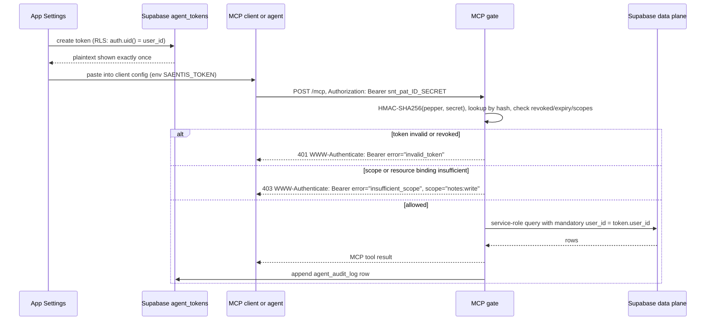
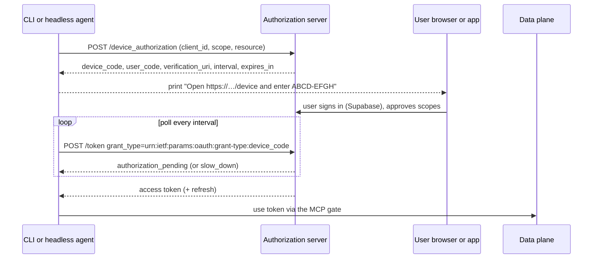
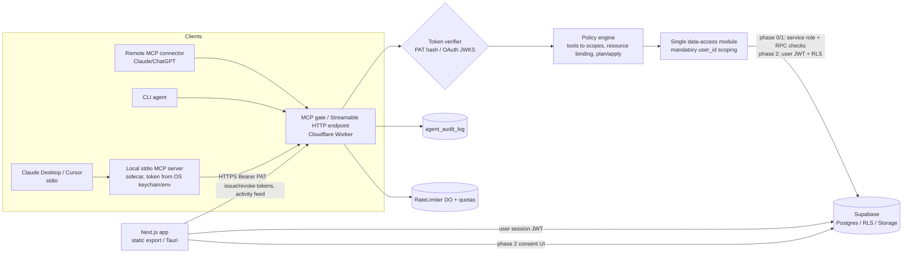

# Agent Authentication & Authorization Model — Saentis Notes

**Status:** Design proposal (no implementation). **Date:** 2026-11-05.
**Scope:** how external AI agents (MCP servers/clients) authenticate as a Saentis/MindViz Notes user and what they are allowed to do.
**Codebase:** Next.js 16 (static export in Tauri 2 / Cloudflare Pages, optional Node server build), Supabase (Postgres + Auth + RLS + Storage), Cloudflare Worker AI proxy, Rust/Tauri commands for the desktop AI path.

**Short version (details in §7):** ship scoped **Personal Access Tokens (A)** now as the single credential type behind one policy-enforcement gate, because it is the only option that works for both stdio and HTTP agents under a static-export/Tauri architecture and because the MCP spec itself directs stdio servers to read credentials from the environment. Reserve **OAuth 2.1 (B)** for the remote-connector phase, and prefer **Supabase's built-in OAuth 2.1 server** over building an authorization server. Do **not** ship Supabase JWT passthrough or a service-role MCP proxy (E).

---

## 1. Current auth architecture (as implemented today)

### 1.1 Session creation, storage, refresh

| Concern | Current behaviour | Where |
|---|---|---|
| Client creation | One browser client, anon key from `NEXT_PUBLIC_SUPABASE_ANON_KEY`, **no options** | `lib/supabase.ts` |
| Sign-in | `signInWithPassword` and `signInWithOAuth({ provider: 'google' })` | `app/login/page.tsx` |
| Session state | `getSession()` + `onAuthStateChange`; `session.access_token` is a Supabase JWT | `lib/auth-context.tsx` |
| Session storage | supabase-js v2 defaults: **`localStorage`** (`sb-<project-ref>-auth-token`), auto-refresh timer on, `detectSessionInUrl` on. No `@supabase/ssr`, **no cookies, no middleware** | implied by `lib/supabase.ts` |
| JWT | HS256 signed with the project JWT secret by default (asymmetric JWKS keys are opt-in in Supabase); `sub`+`aud:"authenticated"`+`role:"authenticated"`, default access-token TTL 3600 s, refresh token rotation | Supabase Auth |
| Route protection | Client-side only: `AuthProvider` in the root layout, pages redirect from React. `app/share/page.tsx` is intentionally public | `app/layout.tsx`, `app/dashboard/page.tsx` → `components/WorkspaceShell.tsx` |

Consequences that matter for agent design:

1. **No secure server-side session.** Any JS running on the origin (or a browser extension) can read the access **and refresh** token from `localStorage`. That is already the app's biggest session-theft surface, and `src-tauri/tauri.conf.json` sets `"csp": null`, so there is no CSP backstop inside the webview either.
2. **No server runtime in the shipped desktop app.** `next.config.js` switches on `TAURI_STATIC_EXPORT`/`NEXT_STANDALONE`; `npm run build:tauri` / `build:pages` produce a static `out/` with **no `/api/*`**. Only `npm run build` (standalone) has server routes. There is no place for a cookie-backed BFF in the desktop build — the agent gate must be an external service (Worker) or the MCP server process itself.
3. **The desktop AI path bypasses HTTP entirely.** `lib/ai.ts` `isTauriRuntime()` invokes the Rust command `ai_chat_json`, which reads the DeepSeek key from the OS keychain (`keyring` service `notesdesktop`) or env (`src-tauri/src/ai_command.rs`). Web uses `/api/ai/chat` or `/api/ai/stream`.

### 1.2 How RLS scopes data today

Every user-owned table follows the same shape: `user_id uuid references auth.users(id) on delete cascade` plus four policies `auth.uid() = user_id` (select/insert/update/delete). Verified in `supabase/schemas/NOTE_SHARES_SCHEMA.sql`, `NOTE_ATTACHMENTS_SCHEMA.sql`, `TASK_CALENDAR_SCHEMA.sql`, `TASK_CALENDAR_ENHANCEMENTS.sql`, `BULLET_JOURNAL_SCHEMA.sql`, `NOTIFICATION_SCHEMA.sql`; `md-docs/FOLDERS_SCHEMA.md` and `md-docs/PROJECTS_SCHEMA.md` show the same for `folders`/`projects`. Tables in play: `notes`, `folders`, `projects`, `note_attachments`, `note_shares`, `ai_chats`, `bullet_journal_entries`, `task_lists`, `tasks`, `subtasks`, `recurrence_patterns`, `calendar_events`, `tags`, `task_tags`, `event_tags`, `reminders`, `time_entries`, `kanban_boards/columns/task_positions`, `notification_preferences/log`.

Notable exceptions / risks:

- **`note_shares` has a public read policy** (`using (published_at is not null)`) on top of the owner policy. Anyone with the anon key can read shared rows by token; `app/share/page.tsx` relies on this. Any agent granted share-creation can publish content to an unauthenticated surface.
- **`ai_chats` and `projects` have no SQL file in this repo** (only docs), so their RLS state is an assumption to verify against the live project before exposing them to agents.
- **Storage**: bucket `user_docs`, objects under `<userId>/...`, signed URLs (30-day expiry in `lib/file-storage.ts`). Storage object policies are not in the repo; verify before granting `files:*`.
- **Offline-first** (`lib/offline/*`, `lib/notes.ts`): IndexedDB cache + outbox per user, writes guarded by `where updated_at = <last server updated_at>`, realtime `postgres_changes` on `notes` filtered by `user_id` reconciles echoes. **A server-side agent write is exactly the kind of "remote writer" this system must absorb** (§5.4).

### 1.3 How the existing server endpoints authenticate

| Endpoint | Auth | Notes |
|---|---|---|
| `POST /api/ai/chat`, `/api/ai/stream` | `Authorization: Bearer <supabase access token>` → `createClient(url, anon).auth.getUser(token)` → `user.id` | `app/api/ai/chat/route.ts`, `stream/route.ts`. No cookies, so no CSRF risk; still, every request costs a GoTrue round-trip |
| `POST /api/ai/key-status` | **None** | Returns `{available, source}`. Minor info leak; should require auth or be removed |
| `POST /api/account/delete` | Bearer user token **plus** `SUPABASE_SERVICE_ROLE_KEY` server env, body `{confirmationText:"DELETE"}` | `app/api/account/delete/route.ts`; admin client deletes the auth user (cascades). **Unreachable in static export**; the client points at `NEXT_PUBLIC_DELETE_ACCOUNT_ENDPOINT` (`components/SettingsModal.tsx`) |
| Cloudflare Worker `POST /api/ai/chat` and `/stream` | Same Bearer check, implemented as a raw `fetch` to `${SUPABASE_URL}/auth/v1/user` with the anon key | `cloudflare/ai-worker/src/index.js`. This is the closest existing template for an MCP gate's token introspection |
| Worker `/api/ai/key-status` | **None** | same minor leak |
| Rust `ai_chat_json` | No user identity at all — it's a local command that uses the local key | no server auth boundary |

Additional observations: rate limiting in the Next routes is an **in-process `Map`** (`app/api/ai/rate-limit.ts`) — per-instance and useless across serverless instances; the Worker correctly uses a Durable Object (`RateLimiterDO`). Worker CORS is opt-in via `ALLOWED_ORIGIN` (exact match, no `Vary: Origin`). The MCP HTTP endpoint will need to be stricter (Origin validation per MCP transport rules, §6).

### 1.4 Secrets and blast radius

| Secret | Where it lives | Blast radius if leaked |
|---|---|---|
| `NEXT_PUBLIC_SUPABASE_ANON_KEY` | **Public** — inlined into every static bundle (verified in `out/_next/static/chunks/*`) | Anything RLS misses: public `note_shares` reads, any table without RLS, storage policy gaps. Rotatable without user impact |
| `DEEPSEEK_API_KEY` | `.env` (gitignored, not tracked), CF Worker secret, or OS keychain in desktop | Direct spend and prompt/data exposure to DeepSeek. **Not** in client bundles (verified). `.env` currently holds a live-looking key — rotate if it was ever shared |
| `SUPABASE_SERVICE_ROLE_KEY` | Next server env only (account delete) | **Full database, cross-tenant, RLS bypass, can delete auth users.** Highest-value secret in the system. Must never appear in the Worker's client-facing responses, repo, or bundle |
| Supabase project JWT secret | Supabase dashboard only | Can mint a token for any `sub`/`role`. Not needed by any design here |
| User Supabase session (localStorage) | Webview/browser profile | Full account access as that user, including refresh token; not agent-scoped |
| Worker secrets (`DEEPSEEK_API_KEY`, and later `AGENT_TOKEN_PEPPER`) | Cloudflare secrets | AI spend; token-hash verification if pepper leaks (tokens themselves are high-entropy) |

---

## 2. Agent authentication options

All options below terminate in **one gate** — the MCP server (Streamable HTTP on a Worker, or the local stdio server) — which is the only component allowed to touch the data layer. MCP's own guidance: HTTP transports *SHOULD* follow the authorization spec; stdio servers *SHOULD NOT* use OAuth and instead **retrieve credentials from the environment** ([MCP Authorization, 2026-07-28](https://modelcontextprotocol.io/specification/2026-07-28/basic/authorization)).

### A. Personal Access Tokens (recommended for phase 0/1)

User-generated in Settings, stored hashed, sent as `Authorization: Bearer snt_pat_…`. Works identically for stdio (env var) and HTTP (header).



- **Pros:** one credential type for stdio and HTTP; no redirect/callback infrastructure in a static-export app; scopes, per-folder binding, per-agent audit and revocation are fully under our control; offline-friendly (token is just a string); opaque tokens cannot be replayed against PostgREST (they are not Supabase JWTs), so the data plane never sees an agent credential; trivial to test.
- **Cons:** copy/paste UX; long-lived bearer with no audience binding and no proof-of-possession; remote connectors (Claude/ChatGPT) generally expect OAuth and will not use a custom header; a token in a dotfile/CI log is a standing risk; the gate must use the **service role** (no user JWT to hand to PostgREST) — see §3.4 for the compensating controls.
- **Effort:** ~1.5–2 weeks (schema, gate, settings UI, stdio wrapper, tests).
- **Sketch:** `agent_tokens` table (§4.1); `lib/agent-tokens.ts` with `mintToken()/hashToken()/verifyToken()` using `crypto.timingSafeEqual`; gate middleware `requireAgent(req)` returning `{userId, tokenId, scopes, binding}`; tool→scope map in one module; `AGENT_TOKEN_PEPPER` Worker secret; Settings → Agents section for issue/revoke/list; per-client config snippets.

### B. OAuth 2.1 authorization server (remote connectors)

Two sub-variants. **B1 (preferred):** use **Supabase's OAuth 2.1 server** as the AS. **B2 (fallback):** build a thin AS and bridge it into Supabase.

**B1 — Supabase as AS.** Supabase can act as an OAuth 2.1/OIDC provider ([docs](https://supabase.com/docs/guides/auth/oauth-server)): PKCE authorization-code flow, an authorization UI that we host on our own origin, dynamic client registration "for MCP-compatible clients", JWKS, AS metadata discovery at `https://<ref>.supabase.co/.well-known/oauth-authorization-server/auth/v1`, and access tokens that are **regular Supabase JWTs plus a `client_id` claim** — so existing RLS keeps working ([token security](https://supabase.com/docs/guides/auth/oauth-server/token-security), [MCP auth](https://supabase.com/docs/guides/auth/oauth-server/mcp-authentication)).

```mermaid
sequenceDiagram
    participant C as MCP client
    participant M as MCP gate
    participant B as User browser
    participant A as Supabase Auth AS
    participant U as Consent UI

    C->>M: POST /mcp without token
    M-->>C: 401 WWW-Authenticate: Bearer resource_metadata="https://mcp.saentis.app/.well-known/oauth-protected-resource", scope="notes:read"
    C->>M: GET protected resource metadata (RFC 9728)
    M-->>C: resource, authorization_servers: ["https://PROJECT-REF.supabase.co/auth/v1"], scopes_supported
    C->>A: GET AS metadata; register client (DCR / pre-registered)
    C->>B: open /authorize?client_id&redirect_uri&code_challenge(S256)&resource&scope&state
    B->>A: authorization request
    A->>U: redirect to configured authorization path (we host this page)
    U->>U: identify user from existing Supabase session, show client + scopes, approve
    U->>A: consent decision
    A-->>B: redirect to redirect_uri with code (+ iss)
    B-->>C: code
    C->>A: token request (code, code_verifier, resource)
    A-->>C: Supabase JWT access token (+ refresh), client_id claim
    C->>M: POST /mcp with Bearer
    M->>M: verify JWT (JWKS), aud, exp, client_id -> mapped scopes/consent
    M->>M: enforce scope + resource binding, append audit row
```

- **Pros:** standards-based, no copy/paste; works with remote MCP connectors that only speak OAuth; user consent screen with real client identity; short-lived access tokens + rotating refresh; revocation and session management reuse Supabase; **tokens are Supabase JWTs, so the gate can call PostgREST as the user and let RLS enforce isolation — no service role in the agent path**.
- **Cons / gotchas (must be designed around):** Supabase's OAuth **scopes are OIDC-only** (`openid`, `email`, `profile`, `phone`) and "do not control access to your database tables" — so `notes:read`/`notes:write` cannot live in the Supabase scope parameter; we need a `client_id`→scopes/consent table plus RLS policies keyed on `auth.jwt()->>'client_id'` and/or custom claims. Default token `aud` is `"authenticated"`, not our MCP resource — to satisfy RFC 8707/9068 audience binding we should add the MCP audience (and the scope claim) through a **Custom Access Token Hook** (Supabase documents hooks applying to OAuth tokens and customizing claims such as audience), then verify it at the gate. **Dynamic Client Registration is deprecated by MCP in favour of Client ID Metadata Documents** ([client registration, 2026-07-28](https://modelcontextprotocol.io/specification/2026-07-28/basic/authorization/client-registration)); Supabase's CIMD support is unverified — spike before committing. Also required: merge Supabase's AS metadata with our own RS metadata, test real clients, and handle the fact that a token issued for the project (aud `authenticated`) is technically being accepted by a server that claims to be a distinct resource — document the trust-domain argument and prefer the hook-added audience.
- **Effort:** ~4–6 weeks including a 3–5 day interop spike (B1). ~6–8 weeks for B2.
- **Sketch (B1):** enable OAuth 2.1 server; set authorization path to `/oauth/consent` (new static-export-safe page using the existing Supabase session); create `agent_oauth_clients`/`agent_oauth_grants` tables; add a custom access token hook that stamps `client_id`, `scope` (space-delimited), and an audience/resource claim for `https://mcp.saentis.app`; add RLS policies `to authenticated using (auth.jwt()->>'client_id' = '…')` where client-specific restriction is needed; MCP gate gets a JWT verifier (JWKS, cached) alongside the PAT verifier; keep PATs as a second token kind.

**B2 — build a thin AS.** Only if B1 cannot express scopes/audience/CIMD acceptably. Serve `/authorize`, `/token`, `/register|/client-metadata` from a Worker; authenticate the user by handing off to the existing Supabase session in the browser; issue short-lived asymmetric JWTs (`sub` = Supabase user UUID, `role:"authenticated"`, `scope`, `client_id`, `aud` = MCP resource); register that issuer in Supabase as a **Custom OIDC** third-party provider ([docs](https://supabase.com/docs/guides/auth/third-party/custom-oidc)) so PostgREST/RLS accept the tokens (`auth.jwt()` claims, `sub`→`auth.uid()`). Constraints: asymmetric signing with `kid`, a `role` claim, ≥30 min for Supabase to pick up key rotation, refresh/revocation are ours to build.

### C. OAuth 2.0 device authorization grant (RFC 8628) — CLI / headless agents



- **Pros:** no localhost listener, no deep links, works over SSH and on locked-down machines; short-lived `user_code` (RFC 8628 §5.3 base-20 code design, §6.1 brute-force protection); the consent UX is closer to OAuth than to copy/paste.
- **Cons:** **not used by MCP clients** — the MCP authorization spec is authorization-code + PKCE, so this only serves agents we ship (CLI, maybe the desktop sidecar's first-run). Needs an AS (Supabase's server does not advertise the device grant), i.e. it belongs to the B2 fallback, not to B1.
- **Effort:** ~1.5–2 weeks on top of B2 (2–3 days on top of B1 only if Supabase adds device grant — verify).
- **Sketch:** `/device_authorization` and `/token` handlers; `device_authorizations` table (`device_code_hash`, `user_code_hash`, `user_id`, `scopes`, `expires_at`, `last_polled_at`); rate-limit user-code attempts per IP and globally; UI page `/device` (works in static export) that shows the code, requires an authenticated Supabase session, and writes consent.

### D. Loopback / browser handoff for a local desktop agent (RFC 8252)

The local stdio MCP server (or the Tauri app on its behalf) gets a token from the browser without the user copying it.

```mermaid
sequenceDiagram
    participant A as Local stdio agent
    participant B as System browser
    participant W as Web app
    participant T as Token endpoint

    A->>A: listen on 127.0.0.1 ephemeral port, generate state and PKCE S256
    A->>B: open browser authorization URL with redirect_uri on 127.0.0.1, state, code_challenge, resource
    B->>W: user already signed in (Supabase session); show consent for agent + scopes
    W-->>B: approve
    B->>A: GET http://127.0.0.1:PORT/cb?code&state  (127.0.0.1 only, no LAN exposure)
    A->>A: verify state + single-use promise, close listener immediately
    A->>T: POST /token (code, code_verifier, client_id)
    T-->>A: agent token (PAT or short-lived JWT)
    A->>A: store in OS keychain (desktop) or config file 0600
```

- **Pros:** excellent UX, no manual copy; consent happens in the real app UI with the user's real session; the token never appears on screen or in shell history.
- **Cons:** requires an AS/token endpoint (or a PAT-exchange endpoint); localhost listeners are an attack surface (bind `127.0.0.1` only, random port, single-use code, ≤2 min TTL, validate `state`, validate `Host`, close after one request); corporate firewalls may prompt; the desktop build would need a Tauri opener/deep-link capability (`shell:allow-open` already exists; **no deep-link plugin is installed**, and custom schemes can be claimed by other apps — loopback is safer than a custom scheme).
- **Effort:** ~3–5 days on top of A or B.
- **Sketch:** `GET /agent/authorize` page; `POST /agent/token` exchange; loopback listener inside the stdio server; `tauri-plugin-deep-link` only if a scheme handoff is later required.

### E. Supabase JWT passthrough / service-role proxy — anti-pattern, do not ship

Two shapes, both wrong for MCP:

1. **Agent holds the user's Supabase session** (copied from `localStorage` or a "copy token" button): full account authority (all notes, files, shares, AI chats), no scopes, no per-agent identity, no per-agent revocation, refresh token included in the worst case. The gate would be a pure proxy — and **MCP explicitly forbids token passthrough**: servers "MUST only accept tokens specifically intended for themselves" and "MUST NOT accept or transit any other tokens" ([authorization spec](https://modelcontextprotocol.io/specification/2026-07-28/basic/authorization), [security best practices: token passthrough](https://modelcontextprotocol.io/docs/2025-11-25/tutorials/security/security_best_practices)).
2. **Gate uses the service role for everything and trusts a `user_id` header/param** from the agent: any parameter-injection or lookup bug is a cross-tenant data breach, RLS is bypassed by design, audit logs show one service identity ("confused deputy" per the same MCP guidance and [RFC 9700 §4.10](https://www.rfc-editor.org/rfc/rfc9700)). The MCP spec's confused-deputy section exists precisely because of this pattern.

Also bad: passing the Supabase token through to upstream APIs, accepting tokens whose `aud` is not the MCP server, or treating a `Mcp-Session-Id` as authentication (the 2026-07-28 revision removed protocol sessions entirely; "MCP servers MUST NOT use sessions for authentication").

The only acceptable variant — and it is a real design point, not a token-passthrough — is B1's Supabase-issued OAuth token used *inside the same trust domain* (Supabase Auth → Supabase PostgREST), with the gate validating it as a resource server would.

### Comparison against MCP authorization expectations

| MCP requirement (2026-07-28) | A. PAT | B1. Supabase OAuth | B2. Own AS | C. Device flow | E. Passthrough |
|---|---|---|---|---|---|
| MCP server as RFC 9728 resource server (PRM + `resource_metadata`) | ✅ (we serve it; 401 challenge advertises scopes) | ✅ | ✅ | ✅ (same RS) | ❌ |
| 401 `WWW-Authenticate` + `scope`, 403 `insufficient_scope` | ✅ | ✅ | ✅ | ✅ | ❌ |
| OAuth 2.1 AS, PKCE S256 | n/a | ✅ | ✅ | ✅ | n/a |
| RFC 8707 `resource` / audience-bound token | ⚠️ opaque token, no audience claim; binding by gate only | ⚠️ default `aud:"authenticated"`; fix with token hook | ✅ | ✅ | ❌ (audience never checked) |
| RFC 9207 `iss` in authorization response | n/a | 🟡 verify during spike | ✅ | ✅ | n/a |
| Client ID Metadata Documents (preferred), DCR (deprecated) | n/a | 🟡 DCR documented; CIMD unverified | ✅ | n/a | n/a |
| Works with stdio agents (env credential) | ✅ | n/a (HTTP only) | n/a | n/a | ✅ |
| Works with remote MCP connectors that only speak OAuth | ❌ | ✅ | ✅ | ❌ | ⚠️ works but unsafe |
| Per-agent revocation / audit identity | ✅ | ✅ (`client_id`, session) | ✅ | ✅ | ❌ |

**Reading of the table:** A covers stdio and header-capable HTTP clients and is the right *first* credential. B1 is the only realistic way to satisfy remote connectors without building an AS. C/D are UX layers, not alternative trust models. E fails the spec on several axes.

---

## 3. Scope model

### 3.1 Canonical scopes

Deny by default; unknown scopes fail closed at issuance **and** at verification. `write` implies the matching `read` (editing requires reading), and **nothing else implies anything** — no wildcards, no prefix matching, no `*`.

| Scope | Grants | Risk | Notes |
|---|---|---|---|
| `notes:read` | list, read, backlinks, note metadata | low | includes title + body content |
| `notes:write` | create, update, move, duplicate (implies `notes:read`) | medium | does **not** grant delete |
| `notes:delete` | trash/delete notes | **high** | separate scope; requires confirmation flow (§5.3) |
| `folders:read` / `folders:write` | folder tree / create-move-rename | low / medium | folder delete is `folders:write` + confirmation |
| `projects:read` / `projects:write` | projects + dashboard metadata | low / medium | |
| `tasks:read` / `tasks:write` | tasks, subtasks, reminders, kanban positions | low / medium | `tasks:write` implies `tasks:read` |
| `calendar:read` / `calendar:write` | calendar events, time entries | low / medium | optional in phase 3 |
| `search` | full-text/keyword search across notes | medium | requires `notes:read` to receive excerpts; without it only counts |
| `files:read` / `files:write` | attachments, `user_docs` storage objects, signed URL minting | medium / **high** | `files:write` can exfiltrate/overwrite attached documents |
| `shares:read` | list published shares + tokens | medium | tokens are bearer secrets for public pages |
| `shares:write` | publish/unpublish a note | **high** | publishing makes content public; confirmation required |
| `account:manage` | account settings, deletion | **critical** | alias for the brief's `admin`; **never grant to agents**, not even in consent UI for phase 1 |

Resource binding (optional, per token): `folder_ids[]`, `project_ids[]`, `note_ids[]` (allowlist) plus a `binding_mode` (`restrict` default). Semantics: reads are filtered to bound subtrees; writes must target a bound folder/project; creating at the root is denied unless the binding explicitly allows root. Binding is **server-enforced at the gate** (it is a token property, not a scope), because RLS alone cannot express "this token may only touch folder X".

### 3.2 Where each scope is enforced

1. **Tool→scope map (authoritative, one module).** The gate refuses unknown tools. Example:

   | MCP tool | Required scopes | Additional guard |
   |---|---|---|
   | `list_notes`, `read_note`, `get_note_backlinks` | `notes:read` | resource binding filter |
   | `search_notes` | `search` + `notes:read` | max results cap (≤50) |
   | `create_note`, `update_note`, `move_note` | `notes:write` | `expected_updated_at` precondition; folder binding |
   | `delete_note` | `notes:delete` | dry-run + confirmation token; trash-first |
   | `list_folders`, `get_folder_tree` | `folders:read` | |
   | `create_folder`, `rename_folder` | `folders:write` | |
   | `list_tasks`, `get_task` | `tasks:read` | |
   | `create_task`, `update_task`, `complete_task` | `tasks:write` | |
   | `list_attachments`, `get_attachment_url` | `files:read` | signed URL TTL ≤ 5 min for agents |
   | `upload_attachment` | `files:write` | MIME allowlist, size cap |
   | `list_shares` | `shares:read` | |
   | `create_share`, `delete_share` | `shares:write` | confirmation + warning that content becomes public |
   | everything else | deny | |

2. **Token verification → context.** `{ userId, tokenId, scopes, binding, clientName, kind }`. The `userId` comes from the token row only — never from a request parameter.
3. **Data layer.** Every query goes through one `agentData` module that takes the context and hard-fails if a `user_id` filter is missing (branded type + runtime assertion + a test that scans for queries without the wrapper). All tool handlers are thin adapters over this module.
4. **RLS stays as the enforcement layer for the app and for OAuth tokens** (B1) — the agent gate needs it only when it can obtain a user-scoped PostgREST credential. With phase 0/1 PATs it cannot, so the gate uses the service role with the controls above **plus** DB-side guardrails: `SECURITY DEFINER` RPCs named `agent_*` that take `p_actor uuid` and check ownership (`user_id = p_actor`) for write paths, `REVOKE` of broad table grants from the gate's DB role where feasible, and integration tests that play two users against every tool. This is the main residual risk of phase 0/1 and a concrete reason to prioritize phase 2 (§7.3).
5. **RLS for OAuth clients (phase 2).** Because Supabase OAuth tokens carry `client_id`, policies can be made client-specific, e.g. `create policy "agents may read notes" on public.notes for select to authenticated using (user_id = auth.uid() and (auth.jwt()->>'client_id') is not null)` — combined with the gate's scope check and a `scope` claim added by the custom access token hook.

### 3.3 Preventing scope confusion

- One canonical parser: `parseScope(raw) -> Set<CanonicalScope>`; reject (not ignore) unknown values; compare sets, never strings.
- Explicit implication table, unit-tested; the consent UI renders the *effective* set.
- Discriminate credential kinds: `snt_pat_…` → PAT verifier; JWT → JWKS verifier; never a single "try both" path that could accept a user JWT as an agent token (a user JWT must be rejected at the agent gate even if valid).
- Bind scopes to the resource (`folder_ids`) so a `notes:write` token cannot write outside its binding.
- Rate/size caps are part of authorization, not just abuse control: `notes:write` cannot bulk-rewrite 10k notes because of the write budget and bulk caps (§4.4).
- Never let a scope be inferred from request content ("the request mentioned a share, so shares:write"). Deny, then step-up.

### 3.4 Scope lifecycle notes

`agent_scope_catalog` (seeded, read-only) is the single source for UI labels/descriptions/risk levels and for validating tokens. Adding a scope is a migration + seed + UI copy change, reviewed as a security change.

---

## 4. Token lifecycle

### 4.1 Storage and schema

Token format: `snt_pat_<env>_<8-char public id>_<43-char base64url secret>` (256-bit CSPRNG). Store only `HMAC-SHA256(pepper, full_token)`; store `token_prefix` (first 20 chars) for UI/secret-scanning, never the secret. `hash_version` allows pepper rotation.

```sql
-- supabase/schemas/AGENT_AUTH_SCHEMA.sql (sketch)
create table public.agent_tokens (
  id uuid primary key default gen_random_uuid(),
  user_id uuid not null references auth.users(id) on delete cascade,
  name text not null,
  token_prefix text not null,
  token_hash bytea not null unique,
  hash_version smallint not null default 1,
  kind text not null default 'pat' check (kind in ('pat','oauth')),
  scopes text[] not null default '{}',
  binding jsonb not null default '{}'::jsonb,        -- {folder_ids:[],project_ids:[],note_ids:[],mode:'restrict'}
  client_name text,
  client_id text,                                     -- OAuth client_id when kind='oauth'
  expires_at timestamptz not null,
  last_used_at timestamptz,
  revoked_at timestamptz,
  revoked_reason text,
  created_at timestamptz not null default now()
);
create index agent_tokens_user_idx on public.agent_tokens (user_id) where revoked_at is null;

create table public.agent_scope_catalog (
  scope text primary key,
  label text not null,
  description text not null,
  risk text not null check (risk in ('low','medium','high','critical')),
  implies text[] not null default '{}'
);

create table public.agent_oauth_grants (               -- phase 2, consent memory
  id uuid primary key default gen_random_uuid(),
  user_id uuid not null references auth.users(id) on delete cascade,
  client_id text not null,
  client_name text,
  resource text not null,
  scopes text[] not null,
  granted_at timestamptz not null default now(),
  last_used_at timestamptz,
  revoked_at timestamptz,
  unique (user_id, client_id, resource)
);

alter table public.agent_tokens enable row level security;
-- users read their own tokens (never the hash in the UI); writes go through a server function
create policy "users read own tokens" on public.agent_tokens for select using (auth.uid() = user_id);
create policy "users revoke own tokens" on public.agent_tokens for update
  using (auth.uid() = user_id) with check (auth.uid() = user_id and revoked_at is not null);
-- no delete policy: revocation is soft, audit trail stays
```

Issuance must happen server-side (Worker) so the plaintext never has to be stored; the settings UI calls `POST /agent/tokens` with the user's Supabase JWT, gets the plaintext once, displays it, then discards it.

### 4.2 Audit log

Append-only, per agent action, written by the gate (service role) and readable by the owner only.

```sql
create table public.agent_audit_log (
  id bigserial primary key,
  user_id uuid not null references auth.users(id) on delete cascade,
  agent_token_id uuid references public.agent_tokens(id) on delete set null,
  client_name text,
  client_id text,
  tool text not null,
  action text not null,                     -- 'read'|'create'|'update'|'delete'|'share'|'denied'
  resource_type text,
  resource_id uuid,
  required_scopes text[] not null default '{}',
  granted_scopes text[] not null default '{}',
  outcome text not null check (outcome in ('allowed','denied','error')),
  error_code text,
  request_id text,
  source_ip inet,
  user_agent text,
  impact jsonb,                             -- {changed_bytes, before_hash, after_hash, item_count}
  duration_ms integer,
  created_at timestamptz not null default now()
);
create index agent_audit_user_time_idx on public.agent_audit_log (user_id, created_at desc);
create index agent_audit_token_time_idx on public.agent_audit_log (agent_token_id, created_at desc);
alter table public.agent_audit_log enable row level security;
create policy "owners read own agent audit" on public.agent_audit_log for select using (auth.uid() = user_id);
-- no insert/update/delete policies: only the gate (service role) writes; retention job prunes > 90 days
```

Notes: never log token values, note bodies, or full prompts; log hashes/sizes/IDs and `request_id` for correlation. Retention 90 days (configurable), delete-by-`created_at` job; GDPR deletion cascades via `user_id`.

### 4.3 Expiry, rotation, revocation

- **Defaults:** read-only tokens 30 days; any write scope 7 days; max 90 days; optional "until revoked" off by default. Absolute expiry plus idle expiry (no use for 30 days → require reissue) for write tokens.
- **Rotation:** issue-new + revoke-old with a 24 h overlap; UI prompts before expiry. OAuth access tokens 10–15 min, refresh token rotating 30 days with reuse detection (OAuth 2.1 §4.3.1).
- **Revocation:** `revoked_at` checked on every request (DB lookup is cheap at our scale; add a 60 s in-memory/KV cache of `tokenId → revoked` but never cache *positive* authorization beyond a few seconds). A "revoke all agent access" button revokes every token for the user, bumps a per-user `agent_epoch` checked by the gate, and (phase 2) revokes Supabase OAuth grants/sessions. Supabase user session revocation does **not** revoke third-party/OAuth access tokens until they expire — the gate must keep checking.
- **Compromise runbook:** revoke token(s) → inspect `agent_audit_log` for the token → show affected notes with before/after hashes → offer revert from stored snapshots → notify by email → rotate `AGENT_TOKEN_PEPPER` (invalidates all hashes; see `hash_version`) → if the service role may be exposed, rotate it in the Worker.

### 4.4 Rate limiting and quotas

Reuse the existing Durable Object pattern (`RateLimiterDO` in `cloudflare/ai-worker/src/index.js`) keyed by `tokenId`, plus DB counters for daily budgets. Suggested defaults: 120 req/min and 30 writes/min per token; 600 req/min per user; bulk cap 100 items/operation; note body ≤ 1 MB; search ≤ 50 results; attachment ≤ 10 MB (existing limit); signed URL TTL ≤ 5 min; daily write budget (e.g. 5 000 note writes/day/user) and a per-agent daily request cap so a runaway agent cannot burn quota. Return `429` + `Retry-After`; return `403` with `insufficient_scope` for scope failures (not 429) so clients do not retry blindly.

### 4.5 Surfacing agent activity in-app

- Settings → **Agents** section (new entry in `SETTINGS_SECTIONS` in `components/SettingsModal.tsx`): token list with name, scopes (plain-language), created/expiry, last used, request count today, revoke/rotate buttons, "create token" wizard.
- **Activity feed** from `agent_audit_log` (RLS select): filters by agent, "writes only", date. Clicking a write opens a diff of the note (store a compact snapshot or before/after HTML hash + changed block ranges in `impact`; store full snapshots in a separate table with 30-day retention if undo is required).
- **Live signal**: the existing `subscribeToNotes` realtime channel already delivers agent writes as echoes; add an "agent changed this note" toast/badge by correlating the echo with a recent audit row (or write `last_agent_token_id` into note metadata — but prefer keeping notes schema clean and correlating server-side).
- **Undo**: "revert this change" writes the previous content back through the same data layer, attributed to the user, and logs an audit entry.

---

## 5. Consent and trust

### 5.1 Agent identity

- **PAT:** identity is a user-chosen label + optional client name; shown to the user as "unverified" — we cannot prove which app holds the token. Be honest in UI (“this token can be used by any app you give it to”).
- **OAuth (B1):** the client is identified by `client_id` and whatever registration path produced it (`client_name`, `client_uri`, `logo_uri`, `redirect_uris`). Show **name + publisher host + exact redirect URI hostname**, as MCP requires for CIMD/localhost flows ([authorization spec, CIMD security](https://modelcontextprotocol.io/specification/2026-07-28/basic/authorization/client-registration)). Never let self-asserted names look verified; label unverified clients.

### 5.2 What the user approves

Consent screen contents: agent name/publisher; signed-in account email; scopes grouped by intent ("Read your notes", "Create and edit notes", "Delete notes — destructive", "Publish notes publicly — makes content readable by anyone with the link"); resource restriction (folder/project picker); duration; a plain "this agent will **not** be able to: delete your account, access billing, act as you elsewhere"; a required checkbox for high-risk scopes. The screen states that this is an AI agent and its actions are logged. Consent is stored in `agent_oauth_grants` (phase 2) or implied by token creation (PAT); changing scopes requires a new grant (no silent widening).

### 5.3 Dangerous operations

| Operation | Policy |
|---|---|
| Delete note/folder/project | `notes:delete`/`folders:write` + **dry-run plan** + confirmation token (§5.3.1); default is trash/soft-delete with a 30-day window, permanent delete is user-only |
| Bulk update (>10 items) | denied unless the client passes an explicit `confirm_bulk:true` and the count ≤ 100; gate returns a plan first |
| Publish/share | `shares:write` + confirmation that content becomes public; never enabled by default; audit warning; share token redacted in logs |
| Move across folders | allowed within binding; outside binding → 403 |
| Account/profile changes | `account:manage` — not grantable to agents |
| AI/LLM spend | not a data scope; separate quota if we expose AI tools |

**5.3.1 Dry-run + plan/apply pattern (recommended).** Any destructive or bulk tool has a preview mode: `delete_note({note_id, dry_run:true})` returns the exact effect (title, size, folder) and a short-lived `plan_id` (signed by the gate, bound to `tokenId`, `userId`, target IDs, expires in 5 min). `delete_note({plan_id})` executes exactly that plan. This makes prompt-injected destructive actions require a second, deliberate call and gives the UI a preview surface if we ever add in-app approval.

**5.3.2 Optional in-app approval.** For users who want it: a `require_approval` token flag makes the gate hold destructive calls and push a request to the app (SSE/polling through a `agent_approvals` table), where the user approves/denies within 2 minutes. Good for "review before write" mode; not required for v1.

### 5.4 Keeping local webview and remote agents consistent

The app is offline-first (`md-docs/OFFLINE_FIRST.md`): optimistic local writes, outbox, `updated_at` conflict guard, realtime reconciliation. Agent writes are server-authoritative and will surface as realtime echoes; two problems need design:

1. **Silent overwrite vs. a user's unsynced local edit.** The user's queued mutation will fail its `updated_at` guard and enter conflict handling — acceptable, but noisy. Agent update tools **must** accept `expected_updated_at` (or content hash) and return `409 stale`, plus `patch` operations over full replace. This turns most races into a clean client-visible conflict instead of a lost edit.
2. **No temp IDs.** Notes created locally and not yet flushed are invisible to the agent (correct). Notes created by the agent appear via realtime and are cacheable; nothing to special-case.
3. **One shared semantic layer.** The MCP tool semantics (note content HTML vs plain text conversion, mindmap JSON, data-sheet structure) must match the app's `lib/notes.ts`/`lib/note-types.ts` behaviour; the data-layer audit (`md-docs/research/agent-integration-data-layer.md`, task-1) is the input for this. Do not duplicate content-conversion logic in the MCP server.

---

## 6. Threat model

| # | Threat | Vector | Impact | Mitigations |
|---|---|---|---|---|
| 1 | Agent token theft | dotfiles, shell history, CI logs, screenshots, malware on desktop | Full scoped access until expiry; data exfiltration; writes | Short expiry for write scopes; server-side revoke + hash-only storage; secret scanning pattern `snt_pat_`; rotate pepper (`hash_version`); audit anomaly detection; display "last used" + IP; never put tokens in URLs |
| 2 | User session theft (bigger than agent tokens) | `localStorage` access via XSS/extension; Tauri `csp: null` | Full account takeover incl. refresh token | Set a Tauri/webview CSP; keep agent tokens out of `localStorage` (gate stores nothing client-side); don't build agent features that copy the user JWT; consider migrating web session to `@supabase/ssr` cookies later (out of scope here) |
| 3 | Prompt-injection-driven exfiltration | malicious note content instructing the agent to read all notes and send them out; poisoned search results | Mass data exfiltration via allowed read scopes | Scope minimization (default read-only); `notes:read` cannot create shares or call arbitrary URLs; no network-egress tools in the server; per-token request/bulk caps; audit + anomaly alerting; treat note content as untrusted input in system prompts; document that `notes:read` on a whole workspace is inherently high-risk |
| 4 | Prompt-injection-driven destructive writes | injected instruction to delete/replace notes | Data loss | Separate `notes:delete`, plan/apply confirmation, soft delete + undo, `expected_updated_at` preconditions, rate/bulk caps, audit diffs |
| 5 | Cross-user access (IDOR / query bug) | missing `user_id` filter in a tool handler; service-role misuse | Critical data breach | Single `agentData` module with branded context + runtime assertion; integration test with two users per tool; `SECURITY DEFINER` RPCs with `p_actor` checks; RLS path in phase 2; never accept `user_id` from the client |
| 6 | Confused deputy | gate forwards its service role / a broad credential; MCP proxy with static client ID | Attacker acts as the gate with full DB access | No token passthrough (MCP forbids it); gate has no “admin” endpoint; per-request identity from token only; least-privilege DB functions; per-client consent (phase 2) |
| 7 | Replay | captured bearer token reused | Unauthorized actions | TLS only; short TTL (OAuth 10–15 min); optional DPoP (RFC 9449) for OAuth tokens later; `request_id` + audit; revocation |
| 8 | Localhost MCP server exposed on LAN | binds `0.0.0.0`, no auth | Any LAN host reads/writes notes | Bind `127.0.0.1` only (MCP transport guidance); require Bearer even on loopback; random port for the D flow; OS firewall; never enable HTTP transport in the desktop app by default |
| 9 | DNS rebinding | malicious website resolves its host to `127.0.0.1` and talks to the local MCP HTTP server | Unauthorized local access | Validate `Origin` on every request, reject invalid with **403** (MCP transport requirement); reject missing Origin from browsers; require `Host` to be loopback; bearer token required; CORS not a security control |
| 10 | Missing/weak Origin checks on the remote MCP endpoint | browser-based cross-site requests to the Worker | CSRF-like abuse (mitigated by Bearer, but still) | Strict `Origin` allowlist → 403 (MCP requires 403 for invalid Origin); no cookies at all on the MCP endpoint; `Vary: Origin`; reject `null`/absent Origin for browser-looking requests |
| 11 | SSRF from MCP tooling / discovery | gate or client fetches attacker-supplied URLs (client metadata, `resource_metadata`, share previews) | Internal network probing, cloud metadata, token leakage | For our own gate: no agent-controlled URL fetching in v1; if added, HTTPS-only, block private/link-local ranges, no redirects unless validated per hop, egress proxy. Clients are responsible for their own SSRF mitigations (MCP security best practices), but our PRM must point only at our real AS |
| 12 | Malicious MCP client | registers many clients, manipulates `redirect_uri`, abuses consent | Consent phishing; tokens for the wrong redirect | Exact redirect match; no wildcards; show redirect hostname; CIMD host trust policy; rate-limit registration; revoke suspicious clients; never auto-approve on subsequent requests for new clients |
| 13 | Malicious/compromised MCP server (the agent-side plugin) | user installs a poisoned MCP server that asks for broad scopes | Data exfiltration under consent | Scope minimization; scopes with confirmation; show publisher; "last used" monitoring; users can revoke; don't grant `files:write`/`shares:write` casually; publish an official config guide |
| 14 | Supply chain | npm MCP SDK, stdio sidecar binary, Tauri updater, Worker deps | Code execution / backdoor in the gate or desktop | Pin/lock deps, lockfile review, no postinstall scripts, signed builds/updater, separate deploy credentials for the MCP worker, no service role on the desktop build |
| 15 | Token leakage into logs/telemetry | gate or client logs Authorization headers | Credential theft | Redaction middleware; never log headers; audit log stores token id only; client snippets tell users not to commit tokens |
| 16 | Public share surface amplifies a compromise | agent with `shares:write` publishes exfiltrated notes | Persistent public exposure | `shares:write` off by default, confirmation, audit, list shares in activity feed, quick "revoke all shares" action |
| 17 | Weak/absent RLS on some tables | `ai_chats`, `projects`, storage policies unverified in repo | Anon-key data exposure independent of agents | Verify and codify RLS in `supabase/schemas/`; add a CI check that every table has RLS enabled; treat as prerequisite for agent scopes on those tables |
| 18 | Replay of user JWT at the agent gate | someone pastes a Supabase token into the MCP client | Gate must not accept it (no scopes, wrong kind) | Token-kind discriminator; reject JWTs on the PAT path and vice versa; audience check on OAuth tokens |

---

## 7. Recommended architecture and rollout

### 7.1 Target architecture



### 7.2 Recommendation

1. **Primary: A (scoped PATs)** for phases 0–1, behind one gate with a single policy module. It is the only option that fits the static-export/Tauri reality, works for stdio (which MCP explicitly expects to use env credentials) and HTTP, and lets us ship read-only safely in ~2 weeks.
2. **Phase 2: B1 (Supabase OAuth 2.1 server)** for remote connectors. Never build an AS before proving B1 cannot meet the requirements.
3. **Fallback: B2 (own thin AS) + C/D** — only if Supabase's OAuth server cannot provide the scopes/audience/CIMD behaviour MCP clients need; the Custom OIDC bridge keeps RLS working.
4. **Never: E.** No user-JWT passthrough, no service-role proxy, no session-based auth.

Design the token model so A and B coexist: same `agent_tokens`/audit/scope catalog, `kind` discriminator, same policy engine; PATs remain valid after OAuth ships (useful for CI/CLI).

### 7.3 Phased rollout

**Phase 0 — read-only agents (~2 weeks).**
- `supabase/schemas/AGENT_AUTH_SCHEMA.sql`: `agent_tokens`, `agent_scope_catalog` (seed), `agent_audit_log` + RLS.
- `lib/agent-tokens.ts`: mint/parse/verify, HMAC pepper, constant-time compare, unit tests.
- `cloudflare/mcp-worker/`: Streamable HTTP `/mcp`; PRM at `/.well-known/oauth-protected-resource`; 401 `WWW-Authenticate` with `resource_metadata` + `scope`; `403` on bad Origin; `RateLimiterDO` per token; tool registry with read-only tools (`list_notes`, `read_note`, `search_notes`, `list_folders`, `list_tasks`, `list_attachments`); audit writer.
- Local stdio server (`mcp/stdio/`, or a bundled sidecar launched by Tauri) reading `SAENTIS_TOKEN`, calling the same Worker endpoint — one PEP, no second data path.
- Settings → Agents UI in `components/SettingsModal.tsx` (+ new `components/settings/AgentsSection.tsx`): create (name, scopes, expiry, folder binding), reveal-once, config snippets, revoke; activity list from `agent_audit_log`.
- Tests: scope matrix, token verification, two-user isolation per tool, revocation, rate limits; CI check that every table has RLS.
- Explicitly **not** exposed: destructive writes, shares, files:write.

**Phase 1 — writes (~2–3 weeks).**
- `notes:write`, `folders:write`, `tasks:write` with `expected_updated_at` preconditions, `patch` operations, size/bulk caps.
- Plan/apply confirmation for delete; soft-delete (trash) first; audit `impact` with before/after hashes and a snapshot table for undo.
- `shares:write`/`files:write` gated behind confirmation and off by default; activity feed gets diff view + revert; realtime "agent changed this note" signal; quota counters and `429`s.
- Compensating controls for the service role: RPC checks, `SECURITY DEFINER` functions, integration tests, documented runbook.

**Phase 2 — OAuth and multi-client (~4–6 weeks).**
- Enable Supabase OAuth 2.1 server; build `/oauth/consent` (static-export-safe) and `agent_oauth_grants`; custom access token hook to stamp `client_id`, `scope`, and audience claim for the MCP resource; AS/RS metadata published; JWKS verification in the gate; client interop tests (Claude, ChatGPT, Cursor, VS Code/Copilot, `mcp-remote`); refresh rotation + reuse detection; per-client RLS policies; move OAuth traffic to PostgREST + RLS (no service role).
- Spike CIMD support; if unavailable, accept DCR (deprecated but functional) with a documented migration plan.
- Optional: device grant for our CLI; loopback handoff for the desktop sidecar; in-app approval mode; DPoP for OAuth tokens.

**Phase 3 — hardening/optional (as needed):** sender-constrained tokens, agent-to-agent delegation (`act` claim via RFC 8693 token exchange), per-project team scopes, agent marketplace/registry listing, admin controls for enterprise.

### 7.4 Concrete work items (design-time naming)

| Item | Path (proposed) | Phase |
|---|---|---|
| Auth schema + RLS + scope seed | `supabase/schemas/AGENT_AUTH_SCHEMA.sql` | 0 |
| Token mint/verify lib | `lib/agent-tokens.ts` | 0 |
| Gate (HTTP MCP + PRM + 401 challenge + Origin + rate limit) | `cloudflare/mcp-worker/src/index.js`, `wrangler.toml` | 0 |
| Tool→scope policy module + data-access module | `cloudflare/mcp-worker/src/policy.js`, `data.js` | 0 |
| Local stdio MCP server | `mcp/stdio/` (package + Tauri sidecar config) | 0 |
| Settings → Agents UI | `components/settings/AgentsSection.tsx`, `components/SettingsModal.tsx` | 0 |
| Agent activity feed + diff/revert | `components/settings/AgentActivity.tsx`, `lib/agent-audit.ts` | 1 |
| OAuth consent + grants | `app/oauth/consent/page.tsx`, `supabase/schemas/AGENT_OAUTH_SCHEMA.sql` | 2 |
| Token hook for scope/audience claims | Supabase dashboard hook (SQL function) | 2 |
| Threat-model tests + CI RLS check | `tests/agent-auth.test.ts`, `scripts/check-rls.js` | 0–1 |

---

## 8. Open questions for the product owner

1. **Principal model:** personal single-user only, or will shared projects/teams arrive? Sharing changes the scope+binding model (per-project membership) and the consent UX.
2. **Which clients must work at launch?** Claude Desktop (stdio), Cursor, ChatGPT/Claude remote connectors, a CLI, or our own desktop agent? The answer decides whether phase 2 starts immediately.
3. **Where may the MCP server run?** A Cloudflare Worker we operate (user data transits it) versus local-only (no remote connectors). Data-residency/DPA implications (Swiss product?).
4. **Is read-only enough for v1?** If yes, keep write scopes behind a feature flag and ship phase 0 only.
5. **Delete semantics:** trash/soft-delete with 30-day recovery, or immediate hard delete? Undo requires snapshots and storage budget.
6. **May agents publish shares?** Recommend "no" for v1; if yes, always with explicit confirmation.
7. **Per-folder/per-project restriction at launch**, or is whole-workspace access acceptable? This is the strongest mitigation against prompt-injection exfiltration, at the cost of UI complexity.
8. **Agent activity surface:** silent audit only, in-app feed, email notifications, or review-before-apply mode? How much in-app UI are we willing to build now?
9. **Retention/legal:** audit-log retention (suggest 90 days), GDPR deletion of audit entries, whether agent actions in shared notes must be attributed publicly.
10. **Billing/quota:** are agent writes free, and do we cap AI-assisted agent calls (DeepSeek spend) per token/plan?
11. **Trust policy for OAuth clients:** allow any CIMD/DCR client, or an allowlist of publishers (Claude/ChatGPT/Cursor only)?
12. **Naming:** the repo/metadata say "MindViz Notes" while the README and this brief say "Saentis Notes" — pick one before writing user-facing consent/publisher text.
13. **Do we ever need agent-to-agent delegation** (an agent acting on behalf of another agent)? If yes, plan for RFC 8693 `act` claims now.
14. **Mobile:** should iOS/Android agents work (deep links, no loopback)? Affects phase 2–3 scope.

---

## References

- [RFC 6749 — The OAuth 2.0 Authorization Framework](https://www.rfc-editor.org/rfc/rfc6749) · [RFC 6750 — Bearer Token Usage](https://www.rfc-editor.org/rfc/rfc6750) · [RFC 9700 — OAuth 2.0 Security BCP](https://www.rfc-editor.org/rfc/rfc9700)
- [RFC 7636 — PKCE](https://www.rfc-editor.org/rfc/rfc7636) · [RFC 8252 — OAuth 2.0 for Native Apps](https://www.rfc-editor.org/rfc/rfc8252) · [RFC 8628 — Device Authorization Grant](https://www.rfc-editor.org/rfc/rfc8628)
- [RFC 7591 — Dynamic Client Registration](https://www.rfc-editor.org/rfc/rfc7591) · [RFC 8414 — Authorization Server Metadata](https://www.rfc-editor.org/rfc/rfc8414) · [RFC 9728 — Protected Resource Metadata](https://www.rfc-editor.org/rfc/rfc9728)
- [RFC 8707 — Resource Indicators](https://www.rfc-editor.org/rfc/rfc8707) · [RFC 9068 — JWT Profile for Access Tokens](https://www.rfc-editor.org/rfc/rfc9068) · [RFC 9207 — Authorization Server Issuer Identification](https://www.rfc-editor.org/rfc/rfc9207) · [RFC 8693 — Token Exchange](https://www.rfc-editor.org/rfc/rfc8693) · [RFC 7662 — Token Introspection](https://www.rfc-editor.org/rfc/rfc7662) · [RFC 9449 — DPoP](https://www.rfc-editor.org/rfc/rfc9449)
- [OAuth 2.1 draft (latest revision -17, Oct 2026)](https://datatracker.ietf.org/doc/draft-ietf-oauth-v2-1/); MCP currently cites `draft-ietf-oauth-v2-1-13`
- [OAuth Client ID Metadata Document draft](https://datatracker.ietf.org/doc/html/draft-ietf-oauth-client-id-metadata-document-00)
- [MCP specification 2026-07-28 — Authorization](https://modelcontextprotocol.io/specification/2026-07-28/basic/authorization) · [Client Registration](https://modelcontextprotocol.io/specification/2026-07-28/basic/authorization/client-registration) · [Streamable HTTP transport](https://modelcontextprotocol.io/specification/2026-07-28/basic/transports/streamable-http) · [2026-07-28 changelog](https://modelcontextprotocol.io/specification/2026-07-28/changelog)
- [MCP Security Best Practices (token passthrough, confused deputy, SSRF, scope minimization)](https://modelcontextprotocol.io/docs/2025-11-25/tutorials/security/security_best_practices)
- [Supabase — OAuth 2.1 Server](https://supabase.com/docs/guides/auth/oauth-server) · [MCP Authentication](https://supabase.com/docs/guides/auth/oauth-server/mcp-authentication) · [Token Security & RLS](https://supabase.com/docs/guides/auth/oauth-server/token-security) · [Third-party auth (Custom OIDC)](https://supabase.com/docs/guides/auth/third-party/custom-oidc) · [Third-party auth limitations](https://supabase.com/docs/guides/auth/third-party/overview) · [JWT signing keys](https://supabase.com/docs/guides/auth/signing-keys) · [RLS](https://supabase.com/docs/guides/database/postgres/row-level-security)
